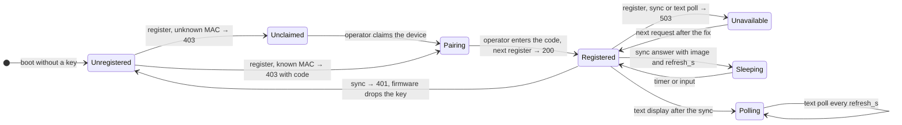

[← Design documents](README.md) · [Paperboy](../../README.md)

# Devices

A device is one panel with Paperboy's firmware. It identifies itself by MAC, keeps a key, and asks for a page every time it wakes.

## Display types

A display type is a file under `displays/<name>.yaml` ([ADR 0071](../adr/0071-display-types-in-files-of-their-own.md)). The file name is the stable name that pages and devices use.

| Key | Meaning |
|---|---|
| `kind` | `image` or `text` |
| `size` | Width and height, in pixels for image types and in characters for text types |
| `gray_levels` | 1, 4 or 16 for image types ([ADR 0105](../adr/0105-sixteen-gray-levels.md)) |
| `ppi` | Pixels per inch, 20–1000, for image types |
| `charset` | `utf8`, `ascii` or `hd44780` for text types; `hd44780` also carries the CGRAM glyphs of [ADR 0155](../adr/0155-cgram-glyphs-on-hd44780-text-displays.md) |
| `min_refresh` | Fastest refresh the panel accepts, in seconds |
| `power` | `auto`, `battery` or `mains` ([ADR 0051](../adr/0051-power-source-refresh-policy.md)) |
| `rotation` | 0, 90, 180 or 270 for image types: the quarter turn from the page to the panel ([ADR 0102](../adr/0102-rotate-pages-onto-the-panel.md)) |
| `grid` | Columns and rows a new image page of this type starts with, 1 to 80 each, default 6 × 8 ([ADR 0128](../adr/0128-a-default-grid-per-display-type.md)) |

The loader and the API validate with the same function. An image type needs `ppi` and rejects `charset`. A text type allows at most 80 × 24 characters and rejects `ppi`, `gray_levels` and `grid`. A `hd44780` display draws the CGRAM glyphs of [ADR 0155](../adr/0155-cgram-glyphs-on-hd44780-text-displays.md); an older firmware shows `?` for them until it updates. A leftover `width_mm` is rejected with a hint: the physical size follows from `ppi` ([ADR 0050](../adr/0050-physical-scaling-by-display-ppi.md)).

## Device files

A device is a file under `devices/<id>.yaml` ([ADR 0070](../adr/0070-devices-in-their-own-files.md)). The file name is the stable ID.

| Key | Meaning |
|---|---|
| `display_type` | Name of a file under `displays/` |
| `protocol` | `paperboy`, the only protocol |
| `mac` | The MAC the device registers with; one device per MAC |
| `plan` | Name of a file under `plans/` |
| `refresh` | Seconds between syncs, down to 1 |
| `power` | Overrides the display type ([ADR 0051](../adr/0051-power-source-refresh-policy.md)) |
| `actions` | `allow` (default) or `deny`: whether `home` opens the menu |
| `alert_methods` | The methods an alert may use: a list of `beep` and `blink`; omitted or empty = silent ([ADR 0132](../adr/0132-alert-methods-per-device.md)) |
| `menu_show_duration` | Seconds until the menu expires, at most 60 ([ADR 0057](../adr/0057-plugin-actions-from-the-plan.md)) |
| `touch` | Draws the menu's tap controls ([ADR 0082](../adr/0082-menu-tap-controls-in-a-strip.md)) |
| `rotation` | Overrides the display type's rotation ([ADR 0102](../adr/0102-rotate-pages-onto-the-panel.md)) |
| `battery` | Thresholds of the battery warning |
| `firmware` | `hold` keeps the device on its firmware |

A device whose `display_type` is not configured still loads, with a `Problem` set ([ADR 0079](../adr/0079-rename-config-items.md)). Its sync and text poll answer 503 with the reason, never 401, so the firmware keeps its key and cannot loop through registration.

## The device API

Both routes are open; a device proves itself with the key from registration ([ADR 0042](../adr/0042-device-protocol.md), [0064](../adr/0064-device-protocol-v4.md)).

### Protocol states

A device moves through registration and sync. Paperboy keeps the key in the
device state, the firmware only uses it.

- **Unregistered** means the firmware has no key. It calls `register` with its
  MAC and hardware.
- **Unclaimed** is an unknown MAC. Paperboy writes a state file without a key
  and shows the device as unclaimed hardware. The answer is 403 without a code.
- **Pairing** is a configured display before its first key. The answer is 403
  with a six-character code, and the panel shows it ([ADR 0109](../adr/0109-pair-a-display.md)).
  The operator enters the code in the device editor. The next register takes
  the key.
- **Registered** is a device with a key. Each wake sends one `sync` and gets
  the image, `refresh_s` and the other fields below.
- **Unavailable** answers 503, never 401, so the firmware keeps its key. A
  device with a `Problem`, a broken configuration and a degraded start cause
  this state ([ADR 0079](../adr/0079-rename-config-items.md)).
- **Sleeping** is a battery device after a successful sync. A timer or an input
  wakes it ([ADR 0051](../adr/0051-power-source-refresh-policy.md)).
- **Polling** is a text display. It stays awake and asks
  `GET /api/device/text` every `refresh_s` ([ADR 0044](../adr/0044-text-displays-on-the-device-api.md)).
- A firmware offer in the sync answer sends the device to an update. It
  downloads the image, flashes it and registers again ([ADR 0043](../adr/0043-firmware-distribution.md)).

**`POST /api/device/register`** takes `mac`, `hardware` and `firmware`. A configured MAC gets `{key, device}`, and an existing key stays. An unknown MAC gets 403, but only after Paperboy wrote `state/devices/<MAC>.json` with hardware, firmware and the first and last contact. The devices tab shows it as unclaimed hardware ([ADR 0080](../adr/0080-device-state-per-mac.md)). `DELETE /api/state/devices/{mac}` forgets it. The unclaimed list holds at most ten entries ([ADR 0137](../adr/0137-bound-unclaimed-device-registration.md)). An eleventh MAC gets 403 without a state file, and the journal logs each unknown MAC once per hour.

The register of a configured display answers 403 with a six-character code until the operator confirmed it ([ADR 0109](../adr/0109-pair-a-display.md)). The panel shows the code. The operator enters it in the device editor, which posts it to `POST /api/state/devices/{mac}/pair`, a UI route. The confirmation authorizes exactly the next register. `Forget` requires a new pairing.

While `paperboy.yaml` is unusable (a degraded start), register, sync and text poll answer 503. The firmware keeps its key and retries, so a server problem never forces a pairing ([ADR 0047](../adr/0047-config-reload.md), [0079](../adr/0079-rename-config-items.md)).

**`POST /api/device/sync`** requires the bearer key and answers 401 without it; the firmware then drops its key and registers again. The body is strict:

| Field | Content |
|---|---|
| `reason` | `timer`, `button`, `touch`, `powercycle`, `menu` or `result` |
| `events` | Button roles `next`, `previous` and `home`, in order, each with a monotonic `id`; `hold_ms` for long presses |
| `shown` | Hash of the page the device displays, which guards the confirmation screen |
| `battery` | `volts` (required), `percent`, `mah`, `ma` (positive while charging) and `charging` |
| `readings` | Measured values of this wake as `{name, value}`; the name comes from Paperboy's reading catalog ([ADR 0134](../adr/0134-readings-from-the-device.md)) |
| `rssi` | Signal strength |
| `log` | Lines that Paperboy writes one by one; a repeated entry carries `time` and `id` and is written once |
| `power` | `battery` or `mains`, if the device can tell |

Events are applied in order before the page is chosen. `previous` wraps. Touches operate the menu when it is open and are only logged otherwise. Paperboy drops an event `id` that is not newer than `last_event_id` in the state file. A repeated request therefore cannot move the cursor twice ([ADR 0064](../adr/0064-device-protocol-v4.md)).

`readings` carries a bare number per name. Paperboy discards a name its catalog does not know, a reading without a value and a value outside the sensor range. Such a reading never fails the sync, so a broken sensor cannot cost the device its page ([ADR 0134](../adr/0134-readings-from-the-device.md)).

The answer carries `image` with a relative `path` and its `hash`, `refresh_s`, `wake` with `reason` and `after_s`, `listen_s`, `sleep` and `time`. It also carries `rotation` when it is not 0. A trigger with an alert asks the device to signal with `beep` and `blink` ([ADR 0131](../adr/0131-a-plan-rule-alerts-the-device.md)). A manual alert of the operator takes the same path ([ADR 0142](../adr/0142-a-manual-alert-waits-for-the-next-sync.md)). The answer carries the firmware offer of [ADR 0043](../adr/0043-firmware-distribution.md) or `null`.

## Timing

The refresh has a floor per power source ([ADR 0051](../adr/0051-power-source-refresh-policy.md)):

- Battery: at least one minute, and at least `min_refresh`.
- Mains: `min_refresh`, which defaults to 1 second for text types and 10 seconds for image types.

A device's `refresh` may go down to one second and is clamped at runtime. `sleep: false` tells a mains device to stay awake and sync again after `refresh_s`.

`refresh_s` is the sleep until the next sync, and a timer sync lands on the grid of its interval ([ADR 0129](../adr/0129-align-timer-syncs.md)). Ten minutes give :00, :10 and :20 in the instance timezone. The device paints before it sleeps, so it syncs a few seconds after the slot. A refresh window edge or a trigger edge caps the sleep; that cap wins and is not stretched, and the next sync aligns again. A slot closer than the floor is skipped, and a slot is never in the past. The grid counts from local midnight, so an interval that does not divide the hour walks through the clock.

`listen_s` is 0 for a timer wake and 20 seconds after input, so the firmware can wait for the next press without registering again. While a menu is open, `listen_s` shortens so that `listen_s` plus `wake.after_s` cover the time left until the menu expires ([ADR 0078](../adr/0078-the-menu-stays-open-while-it-is-used.md)).

`wake` is a one-shot next wake: the menu deadline or an action result. The firmware uses it once and goes back to its normal cycle.

The plan's `on_refresh` decides what a timed refresh shows ([ADR 0130](../adr/0130-what-a-plan-refresh-does.md)). A button press pages the extended list: the visible pages plus the page of the active trigger. An edit keeps the device on its page: the cursor holds the page name ([ADR 0133](../adr/0133-the-page-cursor-holds-the-page.md)). A page that leaves the list is resolved by the mode. `cycle` takes the next page at its declared position, `first` the first page and `current` the page a trigger displaced ([ADR 0158](../adr/0158-plans-are-pages-refresh-windows-and-triggers.md)).

## State

`state/devices/<MAC>.json` holds everything the service knows about a device ([ADR 0080](../adr/0080-device-state-per-mac.md)):

- the page cursor: the index, the page name it holds ([ADR 0133](../adr/0133-the-page-cursor-holds-the-page.md)) and the active trigger
- the last battery reading, the last charging episode and the hourly battery samples of the last week
- the last value of every reading, with the time it was taken
- the menu, with its phase, selection, session and confirmation hash
- a manual alert that waits for the next sync, with its expiry ([ADR 0142](../adr/0142-a-manual-alert-waits-for-the-next-sync.md))
- the address of the last contact ([ADR 0083](../adr/0083-device-address.md))
- `last_event_id`, the reported power source and the key

State belongs to the MAC, not to the file name. A renamed device keeps its cursor, its battery reading and its menu ([ADR 0079](../adr/0079-rename-config-items.md)). A lost `state/devices/` costs only that: the device registers again and starts at its first page.

## Power and battery

The charger and the power source drive three things: the refresh floor, the charge state on the dashboard, and how long the device lasts.

- `power: auto` uses the report of the device and falls back to `battery`. The report is stored as `reported_power`.
- A change of the report or of the charger state gets one `power changed` journal line instead of one per sync.
- Below `warn_volts` the battery warning draws a bar on plan pages. Below `critical_volts` it replaces the page with a full-screen warning, with `hysteresis_volts` to avoid flapping ([ADR 0020](../adr/0020-akkuwarnung-trmnl.md)).
- The dashboard reads the last charge from the gauge current (`charge.go`). It estimates the runtime from the hourly samples (`runtime.go`): the gauge's capacity first, then its percentage, then the voltage, with a least-squares slope.

## Readings

Every reTerminal E series device and the Sticky carry a Sensirion SHT4x temperature and humidity sensor. The firmware takes one measurement per wake, before the sync, and reports it as `temperature` and `humidity` ([ADR 0134](../adr/0134-readings-from-the-device.md)). A failed read sends no value, and the last value with its old time stays.

The catalog in `server/internal/reading` owns the unit, the precision and the plausible range of every reading. A device sends bare numbers, so a wrong firmware offset cannot label a value falsely. Paperboy stores the last value per device and MAC ([ADR 0080](../adr/0080-device-state-per-mac.md)). The dashboard shows the values as a `Readings` row in the card's details, with the catalog names as the tooltip. A reading the last sync did not bring shows its age.

The sensor sits next to the panel and the battery, so it reads slightly warm. There is no calibration yet. A later device-file offset applies to the stored value, not to the widget ([ADR 0134](../adr/0134-readings-from-the-device.md)).

## Device status in widgets

`paperboy/battery`, `paperboy/device-status` and the header's `battery` switch read `server_status` from the plugin request ([ADR 0115](../adr/0115-device-status-in-a-widget.md)). Paperboy fills it from the device the page is rendered for.

A preview without a device gets a sample device ([ADR 0123](../adr/0123-a-sample-device-in-previews.md)). Its id is `preview`; its status is `ok` and its display type the previewed one. It shows 78 %, 4.05 V, not charging and a runtime of about 12 days. It reads no state file and writes no render cache, so every preview shows the same row.

`GET /api/preview/{display}/{page}?device=<id>` draws the page for that device, so the widgets show its real values. The dashboard fallback and the plan preview pass the parameter. A page that names an unknown id keeps its `unknown` row.

## Pages to the device

A composed page is served as `/pages/{display type}/{page}/{hash}.png`, or as QOI with `?format=qoi` for the firmware ([ADR 0072](../adr/0072-pages-as-qoi.md)). Both carry the device key and only serve the display type of the downloading device ([ADR 0097](../adr/0097-page-downloads-take-the-device-key.md)). A notice is `/hints/{hash}.png` in the same two formats.

- Rendered pages live in memory only. After a restart the dashboard omits `last_page_url` and falls back to the page preview.
- QOI never exceeds the firmware's 512 KiB response buffer. No page of the shipped panels can: a paletted page costs at most one QOI byte per pixel ([ADR 0088](../adr/0088-pages-that-do-not-fit-the-buffer.md)). A page above the limit loses its dither and logs a line.
- `rotation` turns the page onto the panel: 0, 90, 180 or 270 degrees clockwise, omitted when 0 ([ADR 0102](../adr/0102-rotate-pages-onto-the-panel.md)). The firmware applies it to the image and to the touch coordinates.

Text displays poll instead: they fetch their lines every `refresh_s`, and an unchanged page answers 304 ([ADR 0044](../adr/0044-text-displays-on-the-device-api.md), [0045](../adr/0045-text-poll-interval-from-the-plan.md)).

A text page also carries `scrolls`: one entry per scrolling box. Each entry names `row`, `col`, `width`, `height`, the full `text`, the first `window`, `direction`, `step_ms` and `align`. `scroll_changed` says whether the scrolling text changed. The firmware keeps its offsets while it is false and starts at the first window when it is true ([ADR 0118](../adr/0118-text-boxes-and-overflow.md)). Horizontal moves a wider line by characters. Vertical moves extra lines down by one line per step. Both move vertically first. Static rows stay as they are. The step comes from the display type's `scroll.step`, not from the firmware. The legacy `scroll` rows remain for older firmware.

## Firmware

The firmware lives in `firmware/esphome/` and is built on ESPHome ([ADR 0041](../adr/0041-esphome-firmware.md)).

| File | Content |
|---|---|
| `common.yaml` | Register, sync, download, listen, beep and blink, deep sleep |
| `paperboy.h` | Sync body with the readings, event queue, wake helpers, rotation, QOI paint, the lockup of the setup screens, text rows and the scroll engine |
| `sticky.yaml`, `e1001.yaml`, `e1003.yaml` | Hardware, buttons, panel driver, buzzer, LED, battery, charger and the room sensor |
| `text-common.yaml`, `lcd2004.yaml` | Text displays, text poll and the marquee script |
| `build.ps1` | Build with a pinned ESPHome (2026.10.1); `-Instance` publishes `firmware/<hardware>-v<version>.bin` |

A sync answer with `beep` or `blink` runs the script of that method after the paint, also when the page did not change ([ADR 0131](../adr/0131-a-plan-rule-alerts-the-device.md)). The device file's `alert_methods` selects the two flags; without the key the device stays silent ([ADR 0132](../adr/0132-alert-methods-per-device.md)). The Sticky beeps; the E1001 and E1003 beep and blink the green LED; the LCD2004 blinks its backlight. The beep is three tones of 90 ms with 70 ms gaps. The cycle waits for the scripts, so deep sleep does not cut the signal off. The buzzer pins are GPIO48 on the Sticky and GPIO45 on the E1001 and E1003; the green LED is on GPIO6 and GPIO16.

A manual alert uses this path on the next sync, also without a plan. One sync consumes it, and the request expires after one hour. The battery warning drops it, because that page carries no alert ([ADR 0142](../adr/0142-a-manual-alert-waits-for-the-next-sync.md)).

A cycle runs one at a time; a second trigger is dropped, so it cannot move the page cursor behind a running download. The firmware connects to the saved BSSID and channel without a scan. It decodes QOI itself into the panel buffer, because ESPHome's decoders spend 2.2–2.6 seconds on 384k pixels. Input during sync or paint is queued for one follow-up sync with a 150 ms settle, so a burst of presses becomes one sync. Failures are noted in RTC memory and reported in the next sync's `log`.

A display in setup repeats its register every 15 seconds for 15 minutes. A claim or a pairing then reaches it without a reset. After that it shows `Retrying in 5 minutes` and asks on a five-minute wake. An unchanged setup text does not repaint, and a new reason (unknown MAC to pairing) starts the fast window again. The text display retries once a minute instead.

An `https://` Paperboy URL is verified against the ESP-IDF CA bundle, which contains the Let's Encrypt roots ([ADR 0108](../adr/0108-verify-the-tls-certificate.md)). `http://` in the LAN stays unencrypted. The check needs a clock. SNTP provides it after a power-on, the RTC keeps it across deep sleep, and the sync answer sets it from `time`. A device without a clock shows the setup screen with the reason.

The only update path is `ota: http_request` with the offer from Paperboy. There is no native ESPHome OTA and no upload in the web UI; a rescue needs USB. Before the flash the panel draws the update screen: the lockup, the offered version and *Installing update…*. A text display prints `Installing update` with the version in its lines. The device stays quiet until it reboots, so the screen says why.

## Hardware findings

Facts from the hardware, kept because they cost time to find.

**E1001** (7.5 in, 800 × 480): the panel is a GDEY075T7 with a UC8179 controller and four gray levels. ESPHome's preset drives it in black and white with a fixed 2 × 2 dither. That puts a dot ring around every antialiased glyph. Since firmware 2.4.0 the pinned external component `uc8179_gray4` draws the four levels directly ([ADR 0086](../adr/0086-four-gray-levels-on-the-e1001.md)). Data polarity and LUT bank differ per batch and are set per device in the web UI ([ADR 0087](../adr/0087-panel-settings-live-on-the-device.md)). Buttons left to right: GPIO5 `previous`, GPIO4 `next`, GPIO3 (green) `home`. Battery on ADC GPIO1 ×2 with enable GPIO21, mapped with Seeed's E10xx curve. USB power is not visible to the ESP32, so an E1001 on a charger needs `power: mains`. Since firmware 2.14.0 the SHT4x sits on a new I2C bus on GPIO19/20 at 0x44. The console moved to UART0, because those pins are the USB pair. The deep sleep current with the bus is not measured yet.

**E1003** (10.3 in, 1872 × 1404, 227 ppi): 16 gray levels, IT8951 controller with a 3 s full refresh. ESP32-S3 with 8 MB PSRAM. Buttons: green GPIO3 `home`, right white GPIO4 `next`, left white GPIO5 `previous`. Battery on ADC GPIO1 ×2 with enable GPIO40, SY6974B charger on I2C 0x6B for `power` and `charging`. Touch is a GT911 on I2C GPIO19/20 without a transform. Since firmware 1.6.0 the SHT4x reports the room on the same bus at 0x44. The preset forces 16 °C and a mirrored X. Deep sleep needs GPIO11/21/38/39/40/45/48 held low and I2C disabled, otherwise the device draws about 4 mA. The image sets `CONFIG_SPIRAM_USE_MALLOC` so that the response copy fits. Measured since 0.1.2: nine pages cycled, sync 0.7 s, paint 1.9–2.7 s.

**Sticky**: gray4 panel that bands luma at 32/96/160, so the firmware maps 0/85/170/255 into the bands. Touch needs `swap_xy`, `mirror_x`, `mirror_y` and rotation 180. Power latch on GPIO45/46 through deep sleep, BQ27220 gauge with currents and capacities ×10, BQ25616 `STAT` on GPIO40 reported as `charging`, charge enable GPIO39. Since firmware 2.13.0 the SHT40 reports the room on the sensor bus GPIO0/1 at 0x44, next to the gauge and the PCF8563.

**Battery readings** for calibration: the Sticky "Küche" reads 3.40 V after a long time without charging. The E1001 "Wohnzimmer" reads 3.75 V. Both fluctuate by about 0.02 V.

## Decisions

[ADR 0020](../adr/0020-akkuwarnung-trmnl.md) (battery warning) · [0041](../adr/0041-esphome-firmware.md) (firmware) · [0042](../adr/0042-device-protocol.md) (device protocol) · [0043](../adr/0043-firmware-distribution.md) (firmware distribution) · [0044](../adr/0044-text-displays-on-the-device-api.md), [0045](../adr/0045-text-poll-interval-from-the-plan.md) (text displays) · [0051](../adr/0051-power-source-refresh-policy.md) (power source) · [0064](../adr/0064-device-protocol-v4.md) (protocol v4) · [0070](../adr/0070-devices-in-their-own-files.md), [0071](../adr/0071-display-types-in-files-of-their-own.md) (device and display type files) · [0072](../adr/0072-pages-as-qoi.md), [0088](../adr/0088-pages-that-do-not-fit-the-buffer.md) (QOI and the buffer) · [0079](../adr/0079-rename-config-items.md) (a missing display type) · [0080](../adr/0080-device-state-per-mac.md) (state per MAC) · [0083](../adr/0083-device-address.md) (address) · [0086](../adr/0086-four-gray-levels-on-the-e1001.md), [0087](../adr/0087-panel-settings-live-on-the-device.md) (gray levels and panel settings on the E1001) · [0097](../adr/0097-page-downloads-take-the-device-key.md) (the device key on downloads) · [0098](../adr/0098-the-device-shows-the-lockup-and-its-version.md) (lockup and version) · [0102](../adr/0102-rotate-pages-onto-the-panel.md) (rotation) · [0105](../adr/0105-sixteen-gray-levels.md) (16 gray levels) · [0123](../adr/0123-a-sample-device-in-previews.md) (the sample device in previews) · [0131](../adr/0131-a-plan-rule-alerts-the-device.md) (the alert) · [0132](../adr/0132-alert-methods-per-device.md) (alert methods per device) · [0134](../adr/0134-readings-from-the-device.md) (readings from the device) · [0137](../adr/0137-bound-unclaimed-device-registration.md) (bounded unclaimed registration) · [0142](../adr/0142-a-manual-alert-waits-for-the-next-sync.md) (a manual alert)
