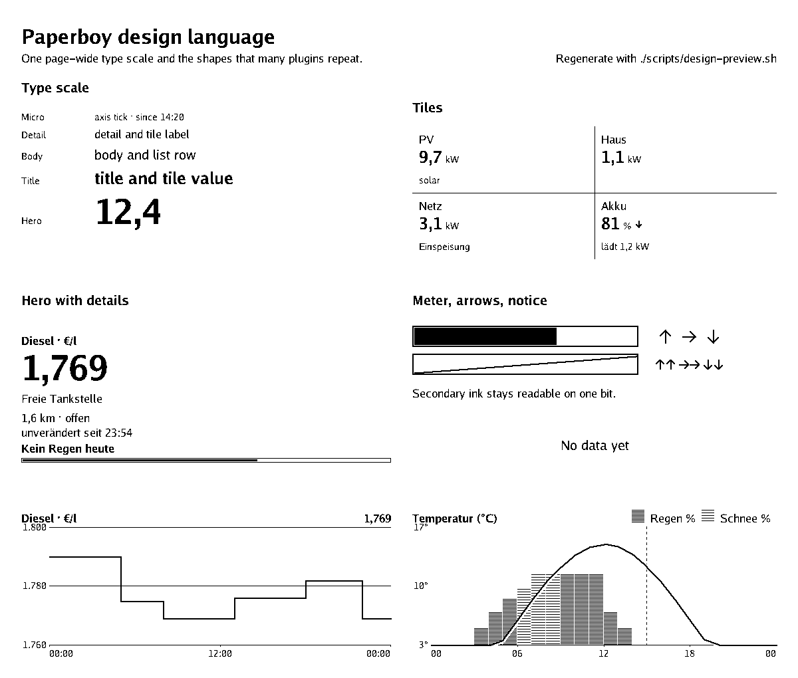

[← Design documents](README.md) · [Paperboy](../../README.md)

# Design language

The design language is the shared look of plugin widgets. It lives in
[`sdk/design`](../../sdk/design) on top of `sdk/render`
([ADR 0151](../adr/0151-a-shared-design-language-for-plugin-widgets.md)). A
plugin still owns its layout and can paint anything itself. The components
remove repeated work and keep the sizes on one scale.

`scripts/design-preview.sh` renders this gallery. It also writes the variant
for the two-level panels:

## The type scale

`design.NewScale(base, cellHeight)` builds the roles from the page's
`text_px`. Only `Hero` follows the cell height.

| Role | Factor | Use |
|---|---|---|
| `Micro` | 0.70 | axis ticks, footnotes, "since 14:20" |
| `Detail` | 0.85 | details, tile label |
| `Body` | 1.00 | list rows, normal text |
| `Title` | 1.25 | widget title, tile value |
| `Hero` | 2.40–2.80 | the one large value |

The roles do not follow the cell height. A label therefore has the same size
in every tile of a page. A plugin that ignores the scale can still use
`render.Text` directly.

### When a component does not fit

Components drop optional content before they shrink type. A tile drops its
detail line, then shrinks the value, then drops the label. A hero drops its
details from the bottom, then the caption, then the note. While optional
content remains, text stays at 80 % of its role or larger. A component that
cannot draw a value returns false, and the plugin answers
`plugin.ErrTooSmall`.

Spacing follows the type size: `design` uses a gap of 0.18 × the text size,
at least two pixels. The page's `padding` and `rule` still come from
`plugin.Style`.

## Components

| Component | Shape |
|---|---|
| `Tiles` | A grid of label, value, unit, detail and optional trend arrow, with thin dividers |
| `DrawHero` | Label, large value with a smaller unit, caption, details, an emphasized note, an optional icon and an optional meter |
| `DrawTrend` | Line, area, step and bar series over time; axis, ticks, "now" mark, title, current value and legend |
| `Sparkline` | A trend without axes, for a tile or a hero |
| `DrawMeter` | An outlined fraction bar; a missing reading gets a slash |
| `Arrow` | A trend arrow for up, flat or down; strength 2 draws a pair |
| `Muted` | Secondary ink: dark gray on four or more levels, black on one bit |
| `Notice` | A centered empty state |

A component draws into an `image.Rectangle` and returns whether it drew. It
does not import `sdk/plugin`, so it knows no widget request, no language and
no unit. The plugin formats the strings and passes them in.

`DrawTrend` supports series with their own `Range`. One chart can therefore
show temperature on the value axis and precipitation probability as bars from
zero to one hundred. A line with `Halo` keeps a white edge above the bars.
`Ticks` and `TickFormat` set the time axis; `Now` adds the dashed marker.

## Which plugins use it

[`evcc`](../plugins/evcc.md) uses `Tiles` for its site widget.
[`fuel`](../plugins/fuel.md) uses `DrawHero` and `DrawTrend`.
[`weather`](../plugins/weather.md) uses `DrawHero` and `DrawTrend`.
[`countdown`](../plugins/countdown.md) uses `DrawHero` and `DrawMeter`.
The other plugins follow in separate changes. The calendar month, the Pokédex
card and xkcd keep their own drawing where the components do not fit.

## What the design language does not change

- The protocol and its version stay unchanged. This is a Go SDK package.
- A widget still draws exactly its cell and still reports `ErrTooSmall`.
- Plugins in other languages keep their own drawing.
- The palette, the fonts and the gray levels stay those of `sdk/render`.
- A page keeps its `padding`, `rule` and `text_px` in points.

## Decisions

[ADR 0151](../adr/0151-a-shared-design-language-for-plugin-widgets.md) (the
design language) · [0049](../adr/0049-plugin-widgets.md) (plugin widgets) ·
[0050](../adr/0050-physical-scaling-by-display-ppi.md) (points and ppi) ·
[0107](../adr/0107-plugin-builds-reach-installations.md) (plugin versions) ·
[0121](../adr/0121-segmented-battery-gauge.md) (the battery gauge).
