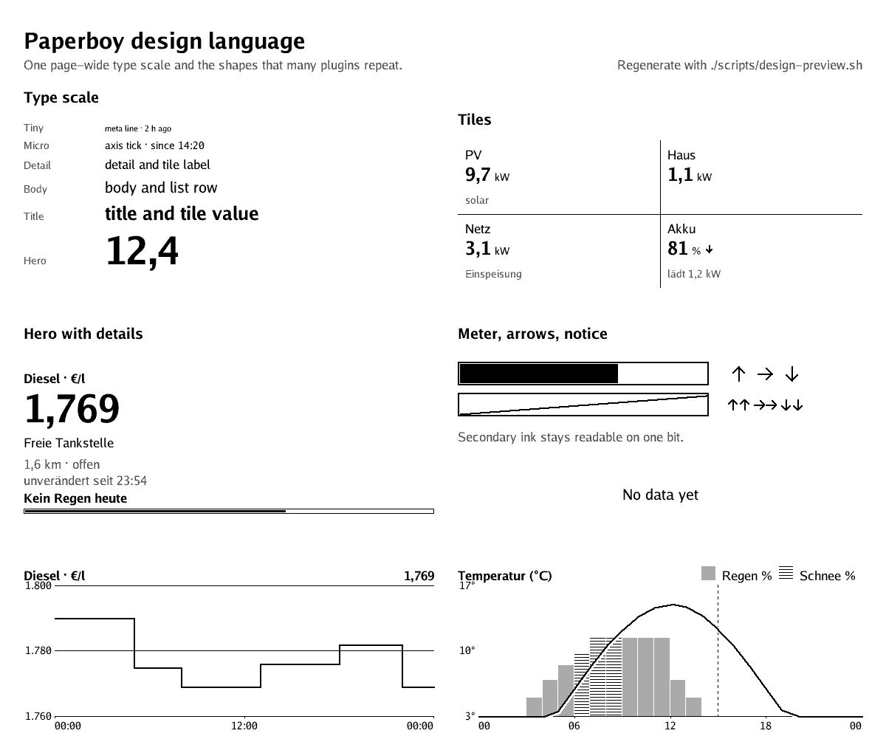

[← Design documents](README.md) · [Paperboy](../../README.md)

# Design language

The design language is the shared look of plugin widgets. It lives in
[`sdk/design`](../../sdk/design) on top of `sdk/render`
([ADR 0151](../adr/0151-a-shared-design-language-for-plugin-widgets.md)). A
plugin still owns its layout and can paint anything itself. The components
remove repeated work and keep the sizes on one scale.

`scripts/design-preview.sh` renders this gallery. It also writes the variant
for the two-level panels:

## The type scale

`design.NewScale(base, cellHeight)` builds the roles from the page's
`text_px`. Only `Hero` follows the cell height.

| Role | Factor | Use |
|---|---|---|
| `Tiny` | 0.55 | dense list metadata, "2 h ago" |
| `Micro` | 0.70 | axis ticks, footnotes, "since 14:20" |
| `Detail` | 0.85 | details, tile label |
| `Body` | 1.00 | list rows, normal text |
| `Title` | 1.25 | widget title, tile value |
| `Hero` | 2.40–2.80 | the one large value |

The roles do not follow the cell height. A label therefore has the same size
in every tile of a page. A plugin that ignores the scale can still use
`render.Text` directly. A chart is another exception: `DrawTrend` caps its
title row at 0.16 of the cell height and its axis at 0.7 of that title. A
short cell keeps room for the plot, a tall cell keeps the scale
([ADR 0160](../adr/0160-a-trend-chart-reads-in-a-short-cell.md)).

`Tiny` is the second line of a dense list, such as an age, an author or a feed
name ([ADR 0152](../adr/0152-a-tiny-role-for-dense-lists.md)). It is not for a
tile label or a chart annotation.

## Numbers

`format.Number(value, decimals, language)` writes `12,4` in German and `12.4`
in English. A plugin uses it instead of a local formatter, so the same value
never gets two spellings. The package lives in
[`sdk/format`](../../sdk/format) and has no drawing code.

### When a component does not fit

Components drop optional content before they shrink type. A tile drops its
detail line, then shrinks the value, then drops the label. A hero drops its
details from the bottom, then the caption, then the note. While optional
content remains, text stays at 80 % of its role or larger. A component that
cannot draw a value returns false, and the plugin answers
`plugin.ErrTooSmall`.

Spacing follows the type size: `design` uses a gap of 0.18 × the text size,
at least two pixels. The page's `padding` and `rule` still come from
`plugin.Style`.

## Components

| Component | Shape |
|---|---|
| `Tiles` | A grid of label, value, unit, detail and optional trend arrow, with thin dividers |
| `DrawHero` | Label, large value with a smaller unit, caption, details, an emphasized note, an optional icon and an optional meter |
| `DrawTrend` | Line, area, step and bar series over time; axis, ticks, "now" mark, labelled extrema, title, current value and legend |
| `Sparkline` | A trend without axes, for a tile or a hero |
| `DrawMeter` | An outlined fraction bar; a missing reading gets a slash |
| `Arrow` | A trend arrow for up, flat or down; strength 2 draws a pair |
| `Muted` | Secondary ink: dark gray on four or more levels, black on one bit |
| `Notice` | A centered empty state |

A component draws into an `image.Rectangle` and returns whether it drew. It
does not import `sdk/plugin`, so it knows no widget request, no language and
no unit. The plugin formats the strings and passes them in.

`DrawTrend` supports series with their own `Range`. One chart can therefore
show temperature on the value axis and precipitation probability as bars from
zero to one hundred. A line with `Halo` keeps a white edge above the bars.
`Ticks` and `TickFormat` set the time axis; `Now` adds the dashed marker.

`Marks` label single points, such as the lowest and the highest value of a
series. `Extrema` finds both points and `ExtremaMarks` turns the `mark`
argument of a widget into marks. A mark is a dot with a white edge and the
formatted value beside it. The label goes to the nearest free place in the
plot, above a maximum and below a minimum when the series leave such a place.
A leader line joins the label to the dot, so the line grows when the curve
needs the room. The label drops when the plot has no room for it at all, but
the dot stays. Without a free place the label keeps a white box, so the series
below does not hide it. A plugin with its own chart, such as `dexcom`, draws
the same dot with `DrawMark`.

## Which plugins use it

[`evcc`](../plugins/evcc.md) uses `Tiles` for its site widget.
[`fuel`](../plugins/fuel.md) uses `DrawHero` and `DrawTrend`.
[`weather`](../plugins/weather.md) uses `DrawHero` and `DrawTrend`.
[`countdown`](../plugins/countdown.md) uses `DrawHero` and `DrawMeter`.
The built-in [`paperboy`](../plugins/paperboy.md) uses `DrawHero` for its
`reading` widget, so a room value reads like any other large value.
[`github`](../plugins/github.md), [`rss`](../plugins/rss.md) and
[`departures`](../plugins/departures.md) use the type scale for their dense
lists. [`myskoda`](../plugins/myskoda.md) and [`prusalink`](../plugins/prusalink.md)
use the scale, the meter and the secondary ink.
[`calendar`](../plugins/calendar.md) uses the scale in the agenda and the week
view; the month grid stays custom. [`dexcom`](../plugins/dexcom.md) uses the
scale for its reading, graph and value rows; the trend arrows and the target
band stay custom.

The Pokédex card and xkcd keep their own drawing where the components do not
fit.

## The action view

A short home replaces an actionable cell with its options (ADR 0162). Paperboy
draws this view, so every plugin looks the same:

- a two-pixel frame marks the cell;
- one tile per choice fills the cell, each with a one-pixel frame;
- the label is the plugin's title, centred and shrunk to the tile;
- a disabled choice is hatched, with a grey label on a white plate;
- on a device without a digitiser the selected choice is inverted: a black
  tile with a white label ([ADR 0163](../adr/0163-the-action-mode-works-with-the-keys.md)).

The tiles take the cell's room: two columns, or one in a portrait cell. A cell
that cannot hold a readable tile says `Cell too small` (German `Feld zu klein`).
The view is part of the served image, so it costs one repaint. A touch device
draws no selection, because the tap names the option.

## What the design language does not change

- The protocol and its version stay unchanged. This is a Go SDK package.
- A widget still draws exactly its cell and still reports `ErrTooSmall`.
- Plugins in other languages keep their own drawing.
- The palette, the fonts and the gray levels stay those of `sdk/render`.
- A page keeps its `padding`, `rule` and `text_px` in points.

## Decisions

[ADR 0151](../adr/0151-a-shared-design-language-for-plugin-widgets.md) (the
design language, extended by [ADR 0152](../adr/0152-a-tiny-role-for-dense-lists.md)
with `Tiny`) · [0049](../adr/0049-plugin-widgets.md) (plugin widgets) ·
[0050](../adr/0050-physical-scaling-by-display-ppi.md) (points and ppi) ·
[0162](../adr/0162-widget-actions-and-the-plugins-choices.md) (the action view), [0163](../adr/0163-the-action-mode-works-with-the-keys.md) (the selection) ·
[0107](../adr/0107-plugin-builds-reach-installations.md) (plugin versions) ·
[0121](../adr/0121-segmented-battery-gauge.md) (the battery gauge).
