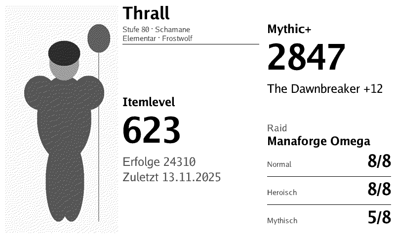
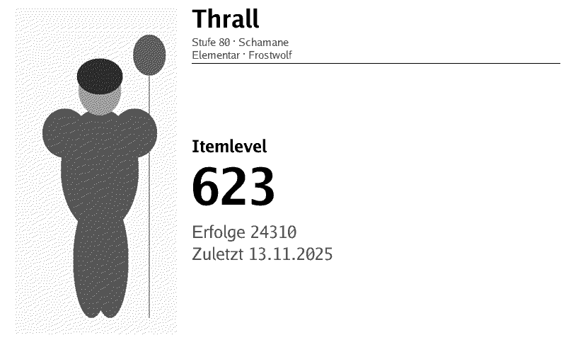
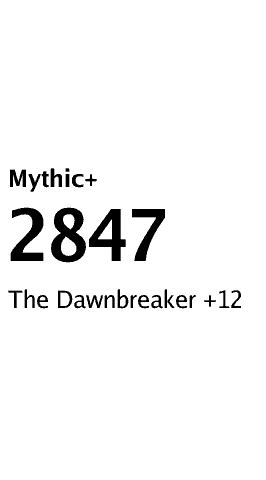
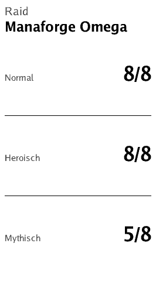
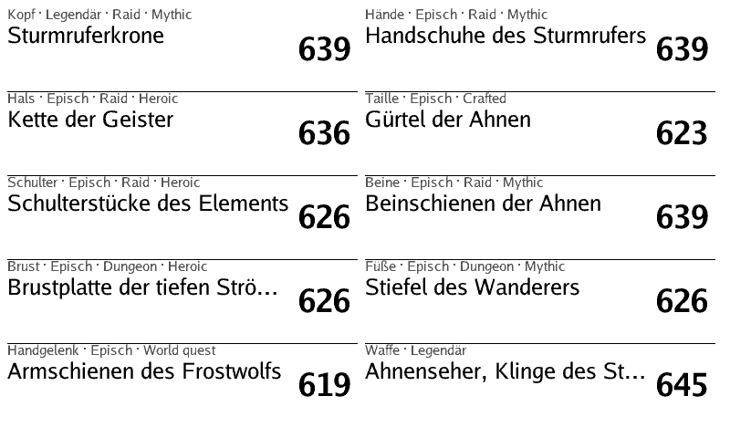

# armory plugin

A World of Warcraft character from [Blizzard's profile API](https://develop.battle.net/documentation/world-of-warcraft/profile-apis)
and [Raider.IO](https://raider.io/api). Blizzard answers the profile, the
render picture and the equipment; Raider.IO answers the Mythic+ score and the
raid progress ([ADR 0181](../adr/0181-a-characters-picture-from-two-apis.md)).

## Screenshots

The example page `wow` with the character, the score and the raid progress:









The example page `wow-ausruestung` with the equipped items:




The render in the pictures is a placeholder that the screenshot generator
draws. The repository ships no artwork of Blizzard Entertainment.

## Configuration

| Key | Description |
|---|---|
| `region` | The game region: `us`, `eu`, `kr` or `tw`, default `eu` |
| `characters` | The characters, as `Name@realm`; a bare name for a ruleset without realms |
| `client_id`, `client_secret` | Blizzard credentials; without them only Raider.IO answers |
| `namespace` | The profile namespace, default `profile-<region>` |
| `base` | Another Raider.IO address |
| `api_base` | Another Blizzard API address; default the region's host |
| `oauth_base` | Another Battle.net OAuth address |
| `refresh` | How long a character's data stays fresh, default `30m`, at least `1m` |

The first configured character is the default of every widget. A widget names
another one with its `character` argument, which also accepts a full
`Name@realm`. One page can therefore show several characters:

```yaml
plugins:
  armory:
    command: [armory]
    config:
      region: eu
      characters: [Thrall@frostwolf, Jaina@proudmoore]
      client_id: "…"
      client_secret: "…"

pages:
  wow:
    cells:
      - { at: [0, 0], span: [3, 8], widget: armory/character, args: { character: Thrall@frostwolf } }
      - { at: [3, 0], span: [3, 4], widget: armory/mythic, args: { character: Jaina@proudmoore } }
```

The realm is the realm's slug: lowercase, with hyphens instead of spaces. A
realm only appears in the address of a retail character; leave it empty for a
ruleset that has no realms.

**Credentials:** create a client at [develop.battle.net](https://develop.battle.net/access/clients)
and put its id and secret into the plugin's config. Paperboy passes the
configuration to the program, so the secret lives in `paperboy.yaml` in clear
text. The file is excluded from git.

**Demand:** a character is fetched when a display needs the page, and again
after `refresh`. The plugin caches per character, so several widgets of one
page cost two requests.

## Widget `character`

The card shows the render on the left and the profile beside it: name, level,
class, specialization, guild, and the item level as the large value. The
achievement points and the last login follow when the column has room.

The render keeps its proportions and is reduced to the gray levels of the
display with error diffusion. Without Blizzard credentials the card shows the
text without a picture.

A cell that is too small for the card answers `ErrTooSmall`.

## Widget `mythic`

The season score as the large value, with the best run below it. Without a
score the widget shows a dash and "no score".

## Widget `raid`

The current tier and its progress per difficulty: normal, heroic and mythic,
each as killed bosses of all bosses. Raider.IO names the tier; a short cell
keeps the tier name and drops the rows.

## Widget `gear`

The equipped items, in the order of the slots: the slot, the rarity and the
origin above, the item's name and item level below. A wide cell uses two
columns; a narrow cell one.

The origin comes from the item's `context`: raid normal, heroic or mythic,
dungeon, Mythic+ or a crafted item. The rarity is the API's own name, so it
follows the language of the display.

The upgrade step ("Myth 4/6") is not part of the answer; the plugin shows it
not ([ADR 0181](../adr/0181-a-characters-picture-from-two-apis.md)).

Args: `count` limits the number of slots, default 10.

## Values

A text page reads these values ([ADR 0111](../adr/0111-text-pages-from-plugin-values.md),
[0120](../adr/0120-arguments-for-values.md)). Every value takes the argument
`character`.

| Value | Type | Precision | Meaning |
|---|---|---|---|
| `name` | text | | the character's name |
| `level` | number | 0 | level |
| `class` | text | | class |
| `spec` | text | | active specialization |
| `guild` | text | | guild, empty without one |
| `item-level` | number | 0 | equipped item level |
| `achievements` | number | 0 | achievement points |
| `mythic-score` | number | 0 | Mythic+ score of the season |
| `raid-progress` | text | | e.g. `8/8 H` |
| `last-login` | timestamp | | last logout |

## Attribution

World of Warcraft and the character renders belong to Blizzard Entertainment.
The plugin fetches them at runtime for a private display and ships nothing.
Raider.IO provides its API for non-commercial use and asks for a link back.
