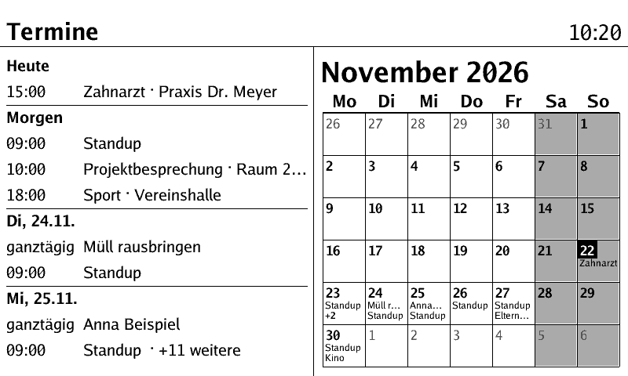
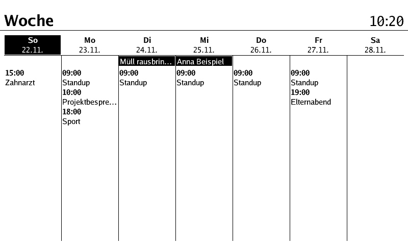
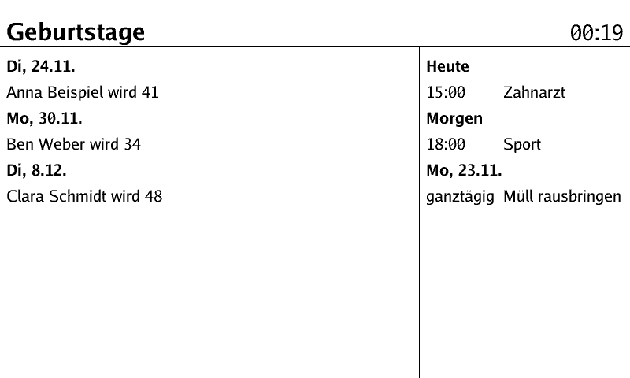
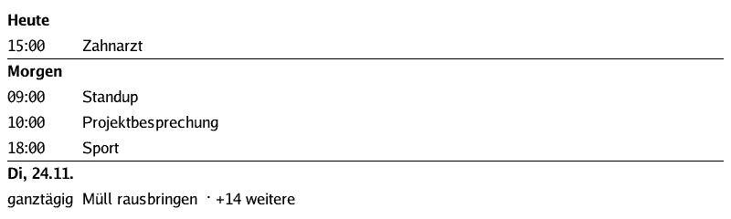
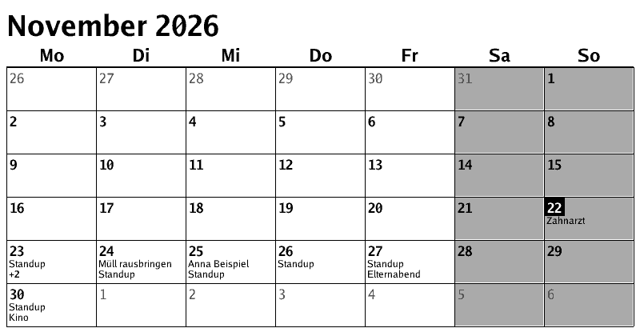
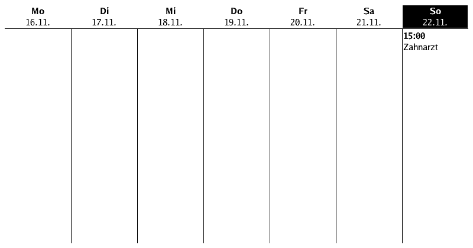
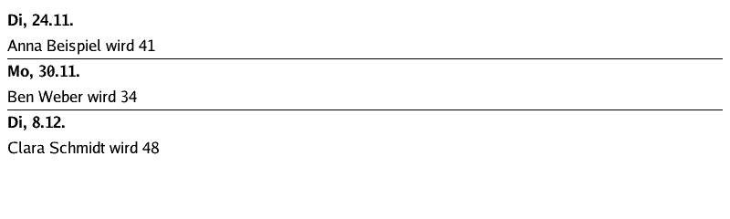

# calendar plugin

Calendars from CalDAV and iCalendar, plus contact birthdays from CardDAV ([ADR 0048](../adr/0048-calendar-provider-and-agenda.md)). The plugin reads the sources in the background and reports changes.

## Screenshots

The example pages `kalender`, `woche` and `geburtstage`:







| `agenda` | `month` | `week` | `birthdays` |
|---|---|---|---|
|  |  |  |  |

The `geburtstage` text page on a 20 × 4 display:

```text
Geburtstage         
Di ganztägig Anna Be
Mo ganztägig Ben Web
Di ganztägig Clara S
```

## Configuration

| Key | Description |
|---|---|
| `caldav`, `user`, `password` | CalDAV access; set the password with `${VAR}` |
| `carddav` | CardDAV server for contact birthdays, e.g. `https://contacts.icloud.com`; uses the same `user` and `password` |
| `calendars` | CalDAV calendar names; default all. An unknown name fails and lists the available ones |
| `birthday_calendars` | Calendars whose yearly events are birthdays; see below. An unknown name fails like `calendars` |
| `ics` | Links; `webcal://` works |
| `ics_files` | Local iCalendar files |
| `days` | Default 14 |
| `max_events` | Maximum number of events |
| `refresh` | Default `15m` |

**Demand:** Paperboy names the next moment a display needs the calendars and the plugin reads then, never more often than `refresh` ([ADR 0126](../adr/0126-a-schedule-event-for-plugin-demand.md)). A page that no display shows costs no request. The plugin requires Paperboy protocol 9.

`calendars` filters at load time and applies to every display. Each widget can narrow the loaded set further with its own `calendars` argument; an empty list shows all loaded calendars. The editors offer the loaded names as check boxes, and an unknown name is an error that lists the available calendars. Before the first successful load the configured names are offered instead; if those are empty too, the editors keep a comma-separated text field.

For iCloud, create an app-specific password at [account.apple.com](https://account.apple.com) and use your Apple ID as `user`. Nextcloud works with an address like `https://cloud.example.org/remote.php/dav`. The plugin follows redirects. It sends the app password only to the same host and to iCloud hosts; a redirect to any other host continues without credentials ([ADR 0141](../adr/0141-keep-caldav-credentials-on-their-hosts.md)).

The plugin expands recurring events itself. If an event uses a rule it does not support (hourly, `BYWEEKNO`, `BYYEARDAY`), it skips that event and logs a warning.

## Birthdays

There are two sources, and both may be active at the same time.

**CardDAV contacts (iCloud).** iCloud's *Geburtstage* / *Birthdays* view is not a CalDAV calendar; it is generated from the contacts. Set `carddav` to the contacts server and the plugin reads the `BDAY` property of every vCard. The birthdays appear under `Kontakte` (German) or `Contacts` in the calendar list and the widget filter, with the age when the card carries a year:

```yaml
plugins:
  calendar:
    config:
      caldav: https://caldav.icloud.com
      carddav: https://contacts.icloud.com
      user: me@icloud.com
      password: ${PAPERBOY_CALDAV_PASSWORD}
      calendars: [Privat]
```

`BDAY` may be `19850412`, `1985-04-12` or a date-time; the time is ignored. A birthday without a year (`--04-12`, or Apple's `BDAY;X-APPLE-OMIT-YEAR=1604:1604-04-12`) still appears, but without an age. iCloud returns contacts in more than one addressbook ("All Contacts" and its groups); the plugin deduplicates them by `UID`. A malformed `BDAY` becomes a warning that names the contact; a contact without a birthday is skipped silently.

**Published birthday calendar (Nextcloud and others).** Some servers publish a read-only calendar built from the contacts: a yearly all-day event per contact that starts on the date of birth (e.g. `DTSTART;VALUE=DATE:19850412` with `RRULE:FREQ=YEARLY`). Add that calendar to `calendars` and name it in `birthday_calendars`:

```yaml
      calendars: [Privat, Geburtstage]
      birthday_calendars: [Geburtstage]
```

The year counts from the first occurrence of the series, so it also works when the calendar only hands out the current year's instance. A missing or implausible year (before 1900, the day of birth itself, more than 130 years) leaves the title alone.

A birthday on 29 February falls on 28 February in a common year, so it does not vanish three years out of four; in a leap year it stays on the 29th.

## Widgets

- `agenda`: day headings, all-day events first, events running into the range from earlier days count, ended events disappear unless `past_today` is set, „+N weitere“ when there are more events than fit – behind the last event when it fits next to it, otherwise on a line of its own. A heading only takes a line when another one is left for the events it introduces, and a cell with events never claims that there are none. Args: `lines`, `headings`, `more` (default true; `false` drops the count and fills the lines with events instead), `location` (multi-line locations such as Apple's name, street and city are joined with commas); `days` limits the range to today plus the following days, 1 to the configured `days` (values outside are clamped), e.g. `days: 2` for today and tomorrow; `empty` (default true when `days` is set) keeps days without events with „Keine Termine“/"No events"; `past_today` (default false) keeps the events of today that have ended and strikes them through, and they give way to the events that have not ended when the cell is short; `age` appends the age of birthdays from `birthday_calendars` and the CardDAV contacts („Anna wird 34“/"Anna turns 34"); `calendars` narrows the events to the named calendars.
- `birthdays`: only the next birthdays from `birthday_calendars` and the CardDAV contacts, always with the age, one line per birthday with the day heading. Args: `lines`, `headings`, `more` (default true, `false` drops the „+N weitere“ count); `days` limits the range to today plus the following days, 1 to the loaded window – the configured `days`, but at least the 42 days the month grid needs – and defaults to that window; `calendars` narrows the birthday sources further. A cell without a birthday in range says „Keine Geburtstage“/"No birthdays". Without either source it stays empty.
- `month`: month grid with titles or event bars; a cell with room for one title line shows that title instead of the `+N` count. Args: `titles: false`; `more` (default true, `false` drops the `+N` count and fills the cells with titles); `calendars`.
- `week`: one column per day. Args: `days` 1-14 (default 7, e.g. 5 for a work week), `start` (`week` or `today`, default `week`), `more` (default true, `false` drops the „+N weitere“ count) and `calendars`; the week starts on Monday for German and on Sunday otherwise. Headings show the weekday and date, today inverted. All-day and multi-day events appear as bars across their days, timed events with their start time and an ellipsized title, and „+N weitere“ marks events that did not fit. A column with room for one event shows that event instead of only the count.

All widgets are for image displays.

## Values

A text page reads these values ([ADR 0111](../adr/0111-text-pages-from-plugin-values.md)):

| Value | Type | Meaning |
|---|---|---|
| `agenda` | text | one line per record: day headings, times and titles, for all loaded calendars |
| `birthdays` | text | one line per birthday with its age, like the `birthdays` widget |
| `week` | text | one line per day of the next seven days |
| `next` | text | title of the first event that has not ended |
| `next-at` | timestamp | its start |

The values take the arguments of the widget they replace ([ADR 0120](../adr/0120-arguments-for-values.md)): `days`, `headings`, `start`, `age`, `location`, `empty`, `more` and `calendars`. Without them they take the widget defaults: every calendar, day headings, the configured number of days. They carry every record; the page's box decides how much of it fits. `past_today` is for image displays only: a text page cannot strike a line, so the `agenda` value leaves the events of today that have ended out.
