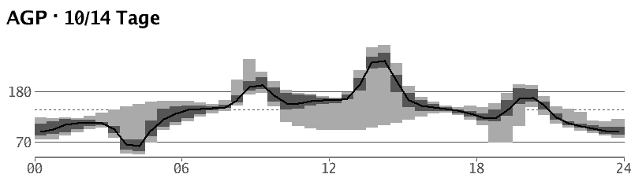
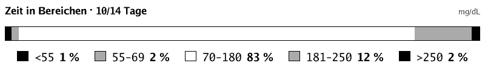
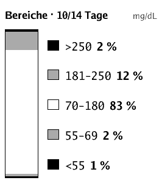
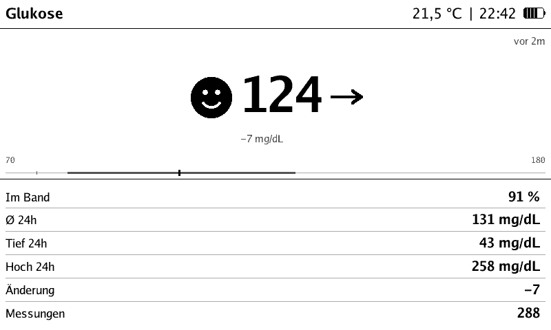
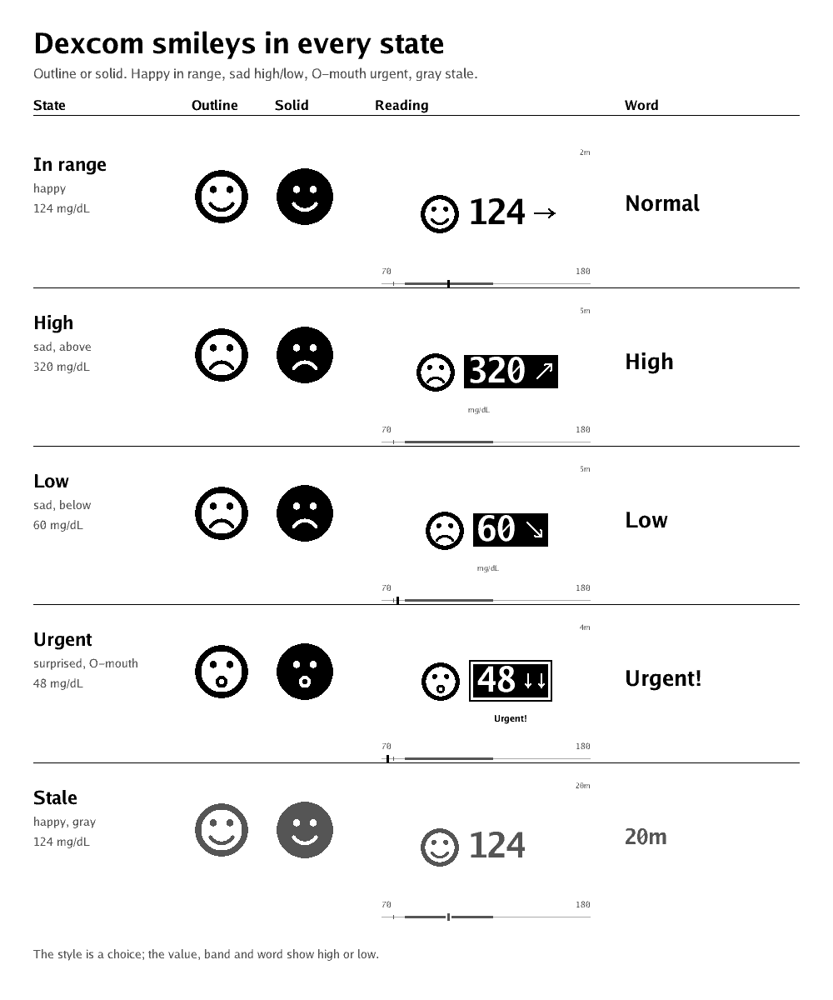

# dexcom plugin

Shows the glucose readings of a Dexcom G7 sensor. The data comes from the Dexcom Share service, the cloud the G7 app uploads to. The sensor itself speaks a proprietary protocol and is not read directly, and Dexcom's developer API is only open to partners, so this plugin takes the path xDrip+, Nightscout's bridge and pydexcom use: the Share endpoints (`share2.dexcom.com` in Europe, `shareous1.dexcom.com` in the US). Those endpoints are not documented for third parties and can change.

Share has to be switched on in the app (Connections → Share). Nothing reaches the cloud otherwise, and the plugin gets no readings while the phone is offline.

## Screenshots

The example page `glukose` shows the current reading, the 24-hour graph and the
numbers of 24 hours:


| `glucose` | `graph` | `values` | `agp` |
|---|---|---|---|
|  |  |  |  |

| `ranges` wide | `ranges` tall |
|---|---|
|  |  |

The example page `glukose-kinder` shows the reading with the smiley and
the numbers of the day in one column:



The `glukose` text page on a 20 × 4 display:

```text
Glukose             
124 mg/dL          →
-7 mg/dL        2min
✓ Normal            
```

## Configuration

| Key | Description |
|---|---|
| `account_name` | Account name (the e-mail address of the Dexcom account); exchanged for the account ID once and then kept in the state |
| `account_id` | The account ID instead, a GUID, if you have it. Give `account_name` or `account_id`, not both |
| `password` | The account password, preferably via `${DEXCOM_PASSWORD}` |
| `app_id` | Required: the application ID (a GUID) of the app that created the share |
| `region` | Required: `eu` or `us`. The account may live on another host than the country it is used in, so the plugin does not guess |
| `base` | Another Share base URL. Overrides the host of the `region`, for a proxy or a test |
| `refresh` | How often the readings are read, default `5m`, at least `1m` |
| `unit` | `auto` (default), `mg/dL` or `mmol/L`. `auto` takes what the account reports: a reading below 30 is mmol/L |
| `urgent` | Threshold of the urgent low, default 55 mg/dL or 3.1 mmol/L; `0` disables the state |
| `low`, `high` | The target range, time in range, default 70 and 180 mg/dL or 3.9 and 10.0 mmol/L |
| `very_high` | Threshold of the very high range of the bar, default 250 mg/dL or 13.9 mmol/L; `0` merges high and very high |
| `tight_low`, `tight_high` | The tight range inside the target range, time in tight range. Without a value the lower edge follows `low` and the upper edge is 140 mg/dL or 7.8 mmol/L, at most `high` |
| `min`, `max` | The scale of the chart, default 40 and 300 mg/dL or 2.2 and 16.7 mmol/L |

**Demand:** Paperboy names the next moment a display needs the readings and the plugin reads then, never more often than `refresh` ([ADR 0126](../adr/0126-a-schedule-event-for-plugin-demand.md)). The `state` value counts as demand while a plan condition names it, because Paperboy reads it before every sync. The plugin requires Paperboy protocol 9.

The defaults are the consensus ranges: time in range (TIR) covers 70 to 180 mg/dL (3.9 to 10.0 mmol/L), time in tight range (TITR) 70 to 140 mg/dL (3.9 to 7.8 mmol/L). Thresholds are read in the unit of the account, so a mmol/L account sets `low: 3.9` rather than `70`. A tight range that the configuration does not name follows the target range, so a moved range keeps its order.

```yaml
plugins:
  dexcom:
    config:
      account_name: ${DEXCOM_ACCOUNT}
      password: ${DEXCOM_PASSWORD}
      app_id: 00000000-0000-0000-0000-000000000000
      region: eu
```

## Widget `glucose`

The widget is for image displays. It shows the reading large, its trend as an arrow, how it moved over the last 15 minutes, its age, and a bar that shows the target band, the urgent threshold and where the value sits in the scale.

Outside the range the value is drawn inverted (light on dark), below `urgent` it gets a ring and the word „Dringend!"/“Urgent!”. A reading older than 15 minutes is drawn gray, loses the inverted box and the urgent word, and its smiley is gray too.

The arrow beside the value is the trend the sensor reports with every reading: the direction and the speed of the change. Dexcom derives it from the last readings and names seven states, from `DoubleUp` (rising faster than 3 mg/dL per minute) over `SingleUp`, `FortyFiveUp` and `Flat` (inside ±1 mg/dL per minute) down to `DoubleDown`. The plugin does not compute it itself; it draws the reported state at 0, ±45 or ±90 degrees and as two arrows for the `Double` states.

The optional `sign` arg adds the smiley to the cell
([ADR 0176](../adr/0176-child-friendly-signs.md)):

| Value | Shows |
|---|---|
| `none` (default) | no smiley |
| `outline` | the face as a line drawing |
| `solid` | the face filled |

```yaml
- { at: [0, 0], span: [2, 3], widget: dexcom/glucose, args: { sign: outline } }
```

### Child-friendly smileys

A child can see the page but cannot read the number. The smiley uses a face and
word instead of colour, so it reads on 1-bit panels and with colour vision
deficiency.

| State | Face | Word |
|---|---|---|
| in the target range | a happy face | `Normal` |
| high | a sad face | `Hoch`/`High` |
| low | a sad face | `Niedrig`/`Low` |
| urgent low | a surprised face with an O-mouth | `Dringend!`/`Urgent!` |
| missing or stale | the happy face in gray | the age or `keine Daten`/`no data` |



`sign` selects the style: `outline` draws the face as a line, `solid` fills it.
The style is a choice for the page; the smiley does not change its weight with
the value.

The happy face means the reading is in the target range. A sad face means it is
above or below it; the value, the band and the word show which. The urgent low
has a surprised face with an O-mouth; the value box, the ring and the word carry
the alarm. A missing or stale reading keeps the happy face in gray. There is no
neutral face, no target and no octagon.

The tight range uses the happy face like the target range. A very high reading
uses the sad face like a high one. `ranges`, `agp` and `values.tight` carry the
clinical detail.

A stale or missing reading draws the value and the smiley in gray. The smiley is
at least 24 px. When the cell is too small, it drops and the value always stays.
High and low share the face; the word and the band show the direction.

The text page needs no smiley. Its labels can carry the CGRAM glyphs of
[ADR 0155](../adr/0155-cgram-glyphs-on-hd44780-text-displays.md):

```yaml
labels: { normal: "✓ Normal", high: "↑ Hoch", low: "↓ Niedrig", urgent: "! Dringend" }
```

## Widget `graph`

The readings of 24 hours (`period: day`, the default) or of the last hour (`period: hour`). The 24-hour window rolls with the clock, so the chart still shows data just after midnight ([ADR 0169](../adr/0169-the-glucose-chart-covers-24-hours.md)). The band is two labelled lines, and the area the curve spends outside the band is filled, so a spike above `high` or a dip below `low` shows how far it went and how long it lasted. The hour variant marks the five-minute points.

`header: false` drops the title (`24 Stunden`/`Letzte Stunde`) and the unit, so the chart itself gets the room. The title and the scale labels follow the base text of the page but never take more than a share of the cell, so the chart still draws in a short cell such as a Sticky's `span: [6,3]` (800 × 180 px).

`mark` (`none`, `min`, `max`, `both`) labels the lowest and the highest reading of the shown window; default `none`. The label is the reading in the configured unit, so a window that peaks at 210 says `210`.

Image displays only.

## Widget `agp`

The ambulatory glucose profile (AGP), the standard report of a CGM: the readings
of several days folded onto one 24-hour grid. Each half-hour slot shows its
median as a line. With readings from three days the slot adds the interquartile
range (25th to 75th percentile) as the dark band and the 5th to 95th percentile
as the light band. The target range is two solid lines and the tight range two
dashed lines, where it differs.

`days` sets the window, default 14 (the AGP standard), from 1 to 30. The title
names the days with readings out of the window; a gap shows as `10/14 Tage`
instead of pretending the window is full. One day shows the curve of that day
without bands; the bands need three days, so a short history never invents a
deviation. The bands are drawn per slot and not smoothed, so a gap in the
readings stays a gap.

The summary of the report over 24 hours — average, TIR, TITR, CV and GMI —
comes from the values below, so a text page or the `values` widget shows it
beside the chart. Those values do not follow the window of the profile.

Image displays only.

## Widget `ranges`

The time in ranges, the stacked bar of the AGP report: very low, low, the target
range, high and very high, each with its share. A wide cell lies the bar down
with the legend below it; a tall cell stands the bar up with the legend beside
it, the high end on top. A short cell keeps the bar and the legend and drops the
title.

`days` sets the window like the `agp` widget, default 14, from 1 to 30, and the
title counts the days with readings the same way. The ranges follow the
configuration: `urgent` is the top of the very low range,
`low` and `high` are the target range and `very_high` the top of the high range.
A `urgent` or `very_high` of 0 merges its range into the next one.

Image displays only.

## Widget `values`

Single values as rows, like the `values` widget of the evcc plugin. The list arg `values` has one check box per entry in the editor:

| Key | Shows |
|---|---|
| `now` | The newest reading with its unit |
| `avg`, `in-band` | Average and share inside the target range over 24 hours |
| `tight` | Share inside the tight range over 24 hours |
| `cv`, `gmi` | Variability (CV) and the glucose management indicator (GMI) |
| `min`, `max` | The lowest and highest reading of 24 hours |
| `delta` | The change over the last 15 minutes |
| `trend` | The trend: the same arrow the `glucose` widget draws |
| `age` | How old the newest reading is |
| `count` | How many readings in 24 hours |
| `band` | The configured target range |

Without `values` all entries are shown; `columns` sets one or two columns. Rows that do not fit the cell are left out, so the order of the list is the order of importance. The widget is for image displays; the values below carry the same data to a text page.

## Values

A text page reads these values ([ADR 0111](../adr/0111-text-pages-from-plugin-values.md)); a value without a reading becomes a dash, except `state`, which answers nothing:

| Value | Type | Unit | Precision | Meaning |
|---|---|---|---|---|
| `state` | enum | | | `normal`, `low`, `high` or `urgent`; no key while the newest reading is older than 15 minutes |
| `glucose` | number | mg/dL or mmol/L | 0 or 1 | the newest reading |
| `trend` | direction | | | 1 up, 0 flat, -1 down, doubled for the double arrows |
| `delta` | number | mg/dL or mmol/L | 0 or 1 | change over the last 15 minutes |
| `age` | duration | | | age of the newest reading |
| `avg` | number | mg/dL or mmol/L | 0 or 1 | average of 24 hours |
| `min`, `max` | number | mg/dL or mmol/L | 0 or 1 | lowest and highest of 24 hours |
| `in-band` | number | % | 0 | share of 24 hours inside the target range |
| `tight` | number | % | 0 | share of 24 hours inside the tight range |
| `cv` | number | % | 0 | coefficient of variation of 24 hours |
| `gmi` | number | % | 1 | glucose management indicator of the mean |
| `count` | number | | 0 | readings of 24 hours |
| `band` | text | | | the target range, e.g. `70–180 mg/dL` |

The unit and the precision follow the configuration or the unit the account reports.

`tight`, `cv` and `gmi` cover the last 24 hours like `avg` and `in-band`, not the
window of the `agp` widget. A figure over 14 or 30 days needs a value of its own
or a window argument; the stored history makes it possible, but no value has it
today.

## The state value in a plan

A plan can switch to a page while the reading is out of its target range ([ADR 0127](../adr/0127-plan-conditions-are-values.md)). The plugin declares one enum value, `state`, with the keys `normal`, `low`, `high` and `urgent`. The urgent range wins over low and high. A missing or stale reading answers no key, so the device never shows an alarm page for data that is gone.

```yaml
rules:
  - name: unterzucker
    when: { conditions: [{ value: dexcom/state, is: [low, urgent] }] }
    pages: [glukose]
  - name: tag
    when: { from: "07:00", to: "22:00" }
    pages: [uebersicht, glukose]
fallback: tag
```

Set `low`, `high` and `urgent` in the plugin configuration; they colour the widget and steer the page switch alike. The device reacts at its next wake, so the `refresh` of the rule that shows the normal page decides how quickly it notices. A plugin that is down or has no data answers no key, and the plan falls through to that rule.

A text cell may label the keys, so the display shows a sentence instead of the key. The label belongs to the page, not to the plugin or the plan:

```yaml
cells:
  - { at: [0, 3], span: [20, 1], value: dexcom/state,
      labels: { normal: Normal, low: Niedrig, high: Hoch, urgent: Dringend } }
```

## Data and state

The service keeps 24 hours. The first read takes the whole 24 hours; after that the plugin asks for the readings it missed since the last poll (`maxCount` = the missed five-minute values plus one for context, at most 288) and merges them into the stored series. It drops duplicates and anything older than 35 days. A poll therefore moves a handful of values instead of a whole window.

The plugin keeps 35 days of readings ([ADR 0175](../adr/0175-keep-five-weeks-of-glucose-readings.md)). The state ([ADR 0081](../adr/0081-plugin-state-over-the-protocol.md), [what a plugin keeps](../design/05-plugins.md#what-a-plugin-keeps)) holds the account ID, the session, the time of the last read, the readings of 24 hours and a compact history of the older readings. The history stores the minute and the value of each reading per UTC hour; the value is in tenths of the account unit. The state stays below 256 KiB; 35 days take about 128 KiB. A restart costs neither a login nor a read, and the first page after a restart has data. A session the service forgot or timed out (`SessionIdNotFound`, `SessionNotValid`) costs one new login; the session is not renewed on every request.

The history starts with the first run. A gap longer than 24 hours is lost because the service does not backfill. The values are stored, not precomputed shares, so a changed target band applies to the whole history. The `agp` and `ranges` widgets fold the stored days; the day widgets and the values stay on 24 hours.

## Privacy

The credentials go only to Dexcom; `${DEXCOM_PASSWORD}` keeps the password out of `paperboy.yaml`. The readings are stored unencrypted under `state/plugins/dexcom/state.json`, readable by the owner of the instance only. The Share API is undocumented and meant for personal use; check what Dexcom allows before sharing the account.
