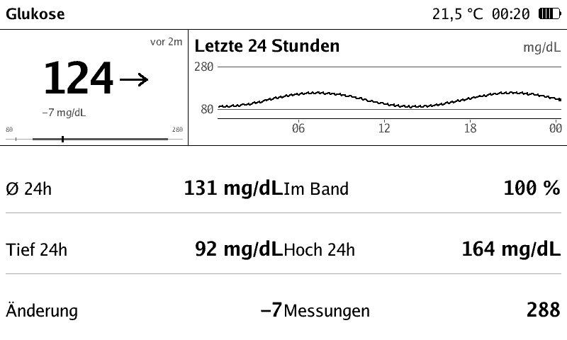
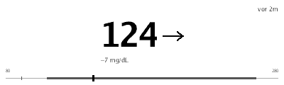
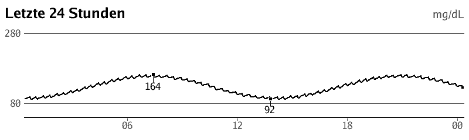
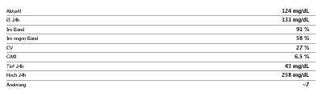

# dexcom plugin

Shows the glucose readings of a Dexcom G7 sensor. The data comes from the Dexcom Share service, the cloud the G7 app uploads to. The sensor itself speaks a proprietary protocol and is not read directly, and Dexcom's developer API is only open to partners, so this plugin takes the path xDrip+, Nightscout's bridge and pydexcom use: the Share endpoints (`share2.dexcom.com` in Europe, `shareous1.dexcom.com` in the US). Those endpoints are not documented for third parties and can change.

Share has to be switched on in the app (Connections → Share). Nothing reaches the cloud otherwise, and the plugin gets no readings while the phone is offline.

## Screenshots

The example page `glukose` shows the current reading, the 24-hour graph and the
numbers of the last 24 hours:



| `glucose` | `graph` | `values` |
|---|---|---|
|  |  |  |

The `glukose` text page on a 20 × 4 display:

```text
Glukose             
124 mg/dL          >
-7 mg/dL        2min
Normal              
```

## Configuration

| Key | Description |
|---|---|
| `account_name` | Account name (the e-mail address of the Dexcom account); exchanged for the account ID once and then kept in the state |
| `account_id` | The account ID instead, a GUID, if you have it. Give `account_name` or `account_id`, not both |
| `password` | The account password, preferably via `${DEXCOM_PASSWORD}` |
| `app_id` | Required: the application ID (a GUID) of the app that created the share |
| `region` | Required: `eu` or `us`. The account may live on another host than the country it is used in, so the plugin does not guess |
| `base` | Another Share base URL. Overrides the host of the `region`, for a proxy or a test |
| `refresh` | How often the readings are read, default `5m`, at least `1m` |
| `unit` | `auto` (default), `mg/dL` or `mmol/L`. `auto` takes what the account reports: a reading below 30 is mmol/L |
| `urgent` | Threshold of the urgent low, default 55 mg/dL or 3.1 mmol/L; `0` disables the state |
| `low`, `high` | The target band, default 80 and 280 mg/dL or 4.4 and 15.5 mmol/L |
| `min`, `max` | The scale of the chart, default 40 and 300 mg/dL or 2.2 and 16.7 mmol/L |

**Demand:** Paperboy names the next moment a display needs the readings and the plugin reads then, never more often than `refresh` ([ADR 0126](../adr/0126-a-schedule-event-for-plugin-demand.md)). The `state` value counts as demand while a plan condition names it, because Paperboy reads it before every sync. The plugin requires Paperboy protocol 9.

The defaults are the numbers of the Dexcom app. Thresholds are read in the unit of the account, so a mmol/L account sets `low: 4.4` rather than `80`.

```yaml
plugins:
  dexcom:
    config:
      account_name: ${DEXCOM_ACCOUNT}
      password: ${DEXCOM_PASSWORD}
      app_id: 00000000-0000-0000-0000-000000000000
      region: eu
```

## Widget `glucose`

The widget is for image displays. It shows the reading large, its trend as an arrow, how it moved over the last 15 minutes, its age, and a bar that shows the target band, the urgent threshold and where the value sits in the scale.

Outside the band the value is drawn inverted (light on dark), below `urgent` it gets a ring and the word „Dringend!"/“Urgent!”. A reading older than 15 minutes is drawn gray instead of as a current value.

The arrow beside the value is the trend the sensor reports with every reading: the direction and the speed of the change. Dexcom derives it from the last readings and names seven states, from `DoubleUp` (rising faster than 3 mg/dL per minute) over `SingleUp`, `FortyFiveUp` and `Flat` (inside ±1 mg/dL per minute) down to `DoubleDown`. The plugin does not compute it itself; it draws the reported state at 0, ±45 or ±90 degrees and as two arrows for the `Double` states.

## Widget `graph`

The readings of the last 24 hours (`period: day`, the default) or of the last hour (`period: hour`). The 24-hour window rolls with the clock, so the chart still shows data just after midnight ([ADR 0169](../adr/0169-the-glucose-chart-covers-the-last-24-hours.md)). The band is two labelled lines, and the area the curve spends outside the band is filled, so a spike above `high` or a dip below `low` shows how far it went and how long it lasted. The hour variant marks the five-minute points.

`header: false` drops the title (`Letzte 24 Stunden`/`Letzte Stunde`) and the unit, so the chart itself gets the room. The title and the scale labels follow the base text of the page but never take more than a share of the cell, so the chart still draws in a short cell such as a Sticky's `span: [6,3]` (800 × 180 px).

`mark` (`none`, `min`, `max`, `both`) labels the lowest and the highest reading of the shown window; default `none`. The label is the reading in the configured unit, so a window that peaks at 210 says `210`.

Image displays only.

## Widget `values`

Single values as rows, like the `values` widget of the evcc plugin. The list arg `values` has one check box per entry in the editor:

| Key | Shows |
|---|---|
| `now` | The newest reading with its unit |
| `avg`, `in-band` | Average and share inside the band over the last 24 hours |
| `min`, `max` | The lowest and highest reading of the last 24 hours |
| `delta` | The change over the last 15 minutes |
| `trend` | The trend: the same arrow the `glucose` widget draws |
| `age` | How old the newest reading is |
| `count` | How many readings the last 24 hours have |
| `band` | The configured target band |

Without `values` all entries are shown; `columns` sets one or two columns. Rows that do not fit the cell are left out, so the order of the list is the order of importance. The widget is for image displays; the values below carry the same data to a text page.

## Values

A text page reads these values ([ADR 0111](../adr/0111-text-pages-from-plugin-values.md)); a value without a reading becomes a dash, except `state`, which answers nothing:

| Value | Type | Unit | Precision | Meaning |
|---|---|---|---|---|
| `state` | enum | | | `normal`, `low`, `high` or `urgent`; no key while the newest reading is older than 15 minutes |
| `glucose` | number | mg/dL or mmol/L | 0 or 1 | the newest reading |
| `trend` | direction | | | 1 up, 0 flat, -1 down, doubled for the double arrows |
| `delta` | number | mg/dL or mmol/L | 0 or 1 | change over the last 15 minutes |
| `age` | duration | | | age of the newest reading |
| `avg` | number | mg/dL or mmol/L | 0 or 1 | average of the last 24 hours |
| `min`, `max` | number | mg/dL or mmol/L | 0 or 1 | lowest and highest of the last 24 hours |
| `in-band` | number | % | 0 | share of the last 24 hours inside the band |
| `count` | number | | 0 | readings of the last 24 hours |
| `band` | text | | | the target band, e.g. `80–280 mg/dL` |

The unit and the precision follow the configuration or the unit the account reports.

## The state value in a plan

A plan can switch to a page while the reading is out of its band ([ADR 0127](../adr/0127-plan-conditions-are-values.md)). The plugin declares one enum value, `state`, with the keys `normal`, `low`, `high` and `urgent`. The urgent range wins over low and high. A missing or stale reading answers no key, so the device never shows an alarm page for data that is gone.

```yaml
rules:
  - name: unterzucker
    when: { conditions: [{ value: dexcom/state, is: [low, urgent] }] }
    pages: [glukose]
  - name: tag
    when: { from: "07:00", to: "22:00" }
    pages: [uebersicht, glukose]
fallback: tag
```

Set `low`, `high` and `urgent` in the plugin configuration; they colour the widget and steer the page switch alike. The device reacts at its next wake, so the `refresh` of the rule that shows the normal page decides how quickly it notices. A plugin that is down or has no data answers no key, and the plan falls through to that rule.

A text cell may label the keys, so the display shows a sentence instead of the key. The label belongs to the page, not to the plugin or the plan:

```yaml
cells:
  - { at: [0, 3], span: [20, 1], value: dexcom/state,
      labels: { normal: Normal, low: Niedrig, high: Hoch, urgent: Dringend } }
```

## Data and state

The service keeps 24 hours. The first read takes the whole 24 hours; after that the plugin asks for the readings it missed since the last poll (`maxCount` = the missed five-minute values plus one for context, at most 288) and merges them into the stored series, dropping duplicates and anything older than 24 hours. A poll therefore moves a handful of values instead of a whole window.

The plugin state ([ADR 0081](../adr/0081-plugin-state-over-the-protocol.md), [what a plugin keeps](../design/05-plugins.md#what-a-plugin-keeps)) holds the account ID, the session, the time of the last read and the readings of the last 24 hours, so a restart costs neither a login nor a read, and the first page after a restart has data. A session the service forgot or timed out (`SessionIdNotFound`, `SessionNotValid`) costs one new login; the session is not renewed on every request.

There is no week or month view: the service does not answer more than 24 hours, and the plugin does not keep its own history. Nightscout or Juggluco would be the source for that.

## Privacy

The credentials go only to Dexcom; `${DEXCOM_PASSWORD}` keeps the password out of `paperboy.yaml`. The readings are stored unencrypted under `state/plugins/dexcom/state.json`, readable by the owner of the instance only. The Share API is undocumented and meant for personal use; check what Dexcom allows before sharing the account.
