# evcc plugin

Shows data from [evcc](https://evcc.io) over its REST API: live values from `/api/state` and the energy history from `/api/history/energy`. The plugin polls the API in the background and sends a change event when a shown value moves. evcc 0.127.0 or newer is required, because older versions report the duration fields in nanoseconds.

## Screenshots

The example page `energie` shows the current energy flow with the site values
and the charging point. `energie-woche` shows the flow of this week in kWh;
`ertrag` compares the energy history of today, yesterday, the week, the month
and the year:

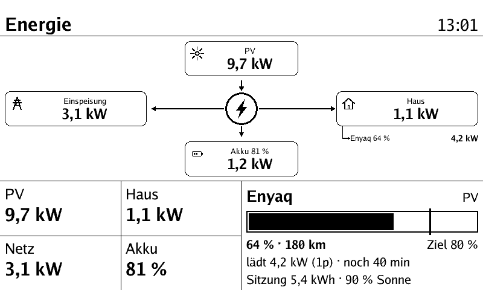

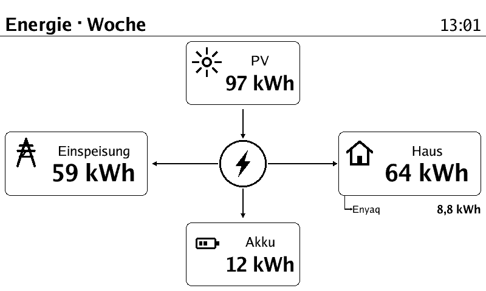

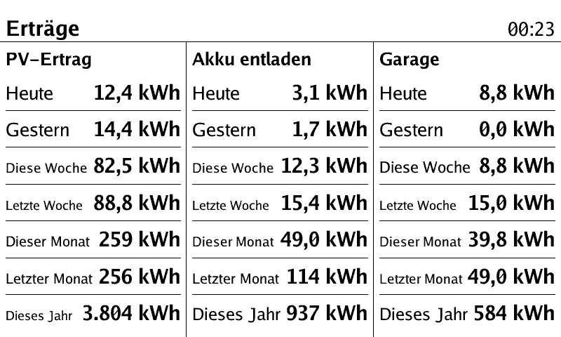

| `site` | `flow` | `balance` | `loadpoint` |
|---|---|---|---|
| 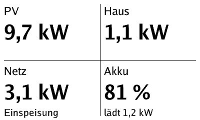 | 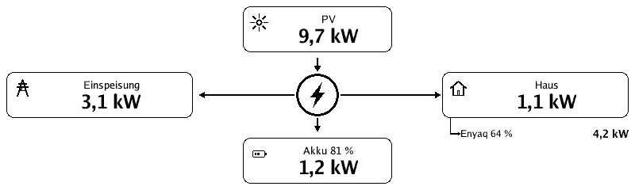 | 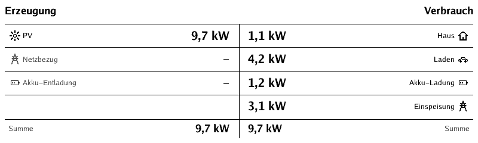 | 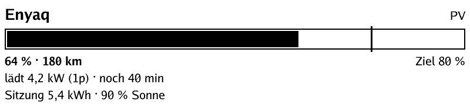 |

| `history` | `values` | `chart` | `forecast` |
|---|---|---|---|
| 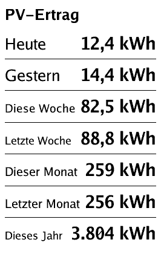 | 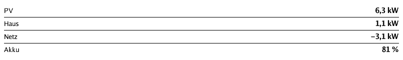 | 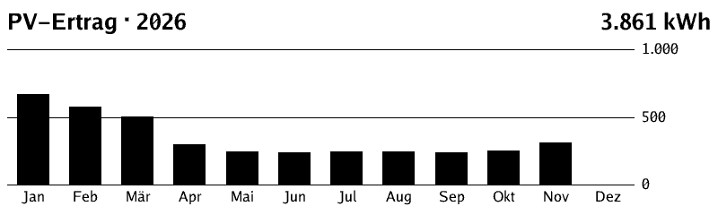 | 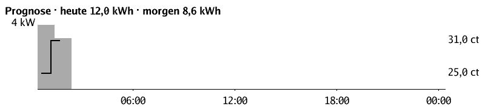 |

## Configuration

| Key | Description |
|---|---|
| `url` | evcc address, e.g. `http://evcc:7070` |
| `refresh` | Poll interval for `/api/state`, default `30s`, at least `10s` |
| `history_refresh` | Interval for the energy history, default `15m`, at least `1m` |

**Demand:** Paperboy names the next moment a display needs evcc's data and the plugin reads then ([ADR 0126](../adr/0126-a-schedule-event-for-plugin-demand.md)). `refresh` and `history_refresh` are the minimum intervals; a page that no display shows costs no request. The plugin requires Paperboy protocol 9.

## Widgets

- `site`: PV, home, grid with import/export, home battery or grid price. Args: `columns` (`2` or `4`, default 2).
- `flow`: energy flow diagram with rounded cards and one line-icon set: the house connection (hub) in the middle, PV above, the battery below, the grid left and the home right. Up to three loadpoints are text lines below the home; a thin tree joins the active ones. The home card stays at the vertical centre, and the group moves up only when the last row would cross the bottom padding. A period lists only loadpoints whose energy is at least 0.05 kWh, so a period without a charging loadpoint shows no rows and no tree. A link exists only while power or energy flows: arrows point into the hub for PV, grid import and battery discharge, and out to the home, the loadpoints, export and charging. An idle node keeps its card and value but has no link. The grid card reads "Grid import" or "Grid export". Links follow Home Assistant's energy distribution: PV serves the home and the loadpoints first, then charges the battery and exports the rest; a deficit comes from the battery before the grid. Args: `period` (`now` default, or `today`, `yesterday`, `week`, `last_week`, `month`, `last_month`, `year`, `last_year`). `now` reads `/api/state` in W; a period sums the energy history of the same categories as the `history` widget, in kWh, and is as current as `history_refresh`. In small cells the pictograms go first, then the state of charge in the labels, then the labels. Sizes follow the display ppi.
- `balance`: the energy split as a T-account. Sources stand on the left (PV, grid import, battery discharge), consumers on the right (home, charging, battery charge, export). The rows are fixed, so a value never moves; a zero shows a gray dash. `Charging (n)` groups all loadpoints. Each side sums its values at the bottom. The widget shows the current power only. The two totals can differ a little because evcc measures each category on its own.
- `loadpoint`: vehicle, mode, a state-of-charge bar with the limit as a tick, range, charge power and phases, remaining time, session energy and solar share. Args: `index` (default 0).
- `forecast`: solar forecast as an area and the grid price as steps for the next `hours` (default 24). Image only.
- `history`: energy totals for today, yesterday, this week (from Monday), last week, this month, last month and this year. Args: `source` (`pv` default, `battery`, `loadpoint`, `grid` or `home`), `metric` (`energy` default, or `return` for the battery's discharge and the grid's export) and `index` (the loadpoint of `/api/state`, default 0). The values come from evcc's energy history (`/api/history/energy`, one request per group with day buckets), so a year is one request; the long periods drop first when the cell is too small. The battery and the grid show the charged or discharged, imported or exported energy, the loadpoint its charged energy.
- `chart`: one series as bars, with the same `source`, `metric` and `index`. `period` selects what the bars are: `today` and `yesterday` one hour each, `week` and `last_week` one day each, `month` and `last_month` one day each, `year` (default) and `last_year` one month each. The heading names the series and the period, the value at the top right is the sum of the bars, the kWh axis stands on the right. Long labels thin out when the cell is narrow; a value dial is not drawn on the bars. Image only.
- `values`: the values evcc reports in `/api/state` and its energy history, one row each with a label and a value. `values` selects them (a list, one check box per entry in the editor), `columns` (`1` to `4`, default 1) puts several next to each other for a wide, flat cell. The entries that do not fit are left out.

| `values` key | Shows |
|---|---|
| `pv`, `home`, `grid` | current power; the grid with + for import and - for export |
| `battery`, `battery-power` | state of charge and power of the home battery |
| `grid-price`, `feedin-price` | the tariffs evcc uses, in ct/kWh |
| `pv-energy` | PV energy since the installation (`pvEnergy`) |
| `grid-import`, `grid-export` | imported and exported energy since the installation |
| `battery-charge`, `battery-discharge` | charged and discharged energy since the installation |
| `charge-total`, `charge-total-solar`, `charge-total-price` | evcc's charging statistics over all sessions: energy, solar share, average price |
| `charge-year`, `charge-year-solar`, `charge-year-price` | the same for this year |
| `pv-today`, `home-today` | PV yield and home consumption of today |
| `grid-import-today`, `grid-export-today` | grid import and export of today |
| `battery-charge-today`, `battery-discharge-today` | battery charged and discharged today |
| `charge-today` | energy of the charging sessions of today, of all loadpoints |
| `forecast-today`, `forecast-tomorrow` | the solar forecast of today and tomorrow |

The values are exactly what evcc reports. Paperboy does not derive numbers of its own: autarky, savings and the self-consumed share that evcc's energy page shows are computed in evcc's web UI from the history and the tariffs and have no API of their own; CO₂ needs a CO₂ tariff.

## Values

A text page reads these values ([ADR 0111](../adr/0111-text-pages-from-plugin-values.md)); a value evcc does not report becomes `–`:

| Value | Type | Base unit | Progression | Meaning |
|---|---|---|---|---|
| `pv`, `home`, `grid` | number | W | kW (1), MW (2) | power; the grid with + for import and - for export |
| `battery` | number | % | | state of charge of the home battery |
| `battery-power` | number | W | kW (1), MW (2) | battery power; + for discharge, - for charge |
| `grid-price`, `feedin-price` | number | ct/kWh | | the tariffs evcc uses |
| `pv-energy` | number | Wh | kWh (1), MWh (2) | PV energy since the installation |
| `grid-import`, `grid-export` | number | Wh | kWh (1), MWh (2) | imported and exported energy since the installation |
| `battery-charge`, `battery-discharge` | number | Wh | kWh (1), MWh (2) | charged and discharged energy since the installation |
| `charge-total` | number | Wh | kWh (1), MWh (2) | energy of all charging sessions |
| `charge-total-solar` | number | % | | solar share of all sessions |
| `charge-total-price` | number | ct/kWh | | average price of all sessions |
| `charge-year`, `charge-year-solar`, `charge-year-price` | | | | the same for this year |
| `pv-today` | number | Wh | kWh (1), MWh (2) | PV yield of today |
| `home-today` | number | Wh | kWh (1), MWh (2) | home consumption of today |
| `grid-import-today`, `grid-export-today` | number | Wh | kWh (1), MWh (2) | grid import and export of today |
| `battery-charge-today`, `battery-discharge-today` | number | Wh | kWh (1), MWh (2) | battery charged and discharged today |
| `charge-today` | number | Wh | kWh (1), MWh (2) | energy of the charging sessions of today |
| `forecast-today`, `forecast-tomorrow` | number | Wh | kWh (1), MWh (2) | solar forecast of today and tomorrow |
| `loadpoint` | text | | | vehicle or name of the first loadpoint |
| `loadpoint-mode` | text | | | its charge mode |
| `loadpoint-status` | text | | | charging, connected or not connected |
| `loadpoint-soc` | number | % | | its state of charge |
| `loadpoint-limit` | number | % | | its charge limit |
| `loadpoint-range` | number | km | | its range |
| `loadpoint-power` | number | W | kW (1), MW (2) | its charge power |
| `session-energy` | number | Wh | kWh (1), MWh (2) | energy of its session |
| `session-solar` | number | % | | solar share of its session |
| `remaining` | duration | | | time until it is full |

The table names the base unit the plugin answers in and the larger steps Paperboy may use. Paperboy writes a value in the largest step whose rounded absolute value is at least 1 ([ADR 0122](../adr/0122-hide-and-progress-a-unit.md)). A cell's `scale` forces a step, and `unit: none` hides the unit text.

```yaml
cells:
  - { at: [0, 2], span: [9, 1], value: evcc/pv, label: PV }
  - { at: [9, 2], span: [11, 1], value: evcc/pv, scale: W, align: right }
  - { at: [0, 3], span: [20, 1], value: evcc/pv-energy, unit: none }
```

The loadpoint values read the argument `index`, the loadpoint counted from 0 (default 0), like the `loadpoint` widget. A `values` request carries one argument set, so the other values ignore it.

The daily values read the same cached energy history as the `history` widget, so a page and the widget agree. They are as current as the last `history_refresh` (15 minutes by default). That loop reports a change, so the page asks again after a refresh. `charge-today` follows the loadpoint values: it sums all loadpoints of `/api/state` without `index` and reports one with it. The history carries no solar share per day, so there is no `charge-today-solar`.

The history needs an evcc with the energy database (the *Energie* page in evcc's UI). An older evcc leaves the other widgets working: the history cell shows the HTTP error instead of values, and the daily values answer `–`. That dash is never an error, and the instant values keep working.

```yaml
cells:
  - { at: [0, 1], span: [2, 7], widget: evcc/history, args: { source: pv } }
  - { at: [2, 1], span: [2, 7], widget: evcc/history, args: { source: battery, metric: return } }
  - { at: [4, 1], span: [2, 7], widget: evcc/history, args: { source: loadpoint, index: 0 } }
```

## Actions

The plugin offers one action, `mode`, which sets an evcc charge mode from the device menu ([ADR 0057](../adr/0057-plugin-actions-from-the-plan.md)). A mode change affects the car, so Paperboy asks for a confirmation before the action runs.

| Argument | Description |
|---|---|
| `loadpoint` | Required. Index into `loadpoints` of `/api/state`, the same order the `loadpoint` widget uses. |
| `mode` | Required. One of `off`, `minpv`, `pv`, `now`. |

The title names the loadpoint and the mode, e.g. "Wohnmobil: jetzt laden"; a plan's `title` overrides it. The action is unavailable while evcc has no data yet, the loadpoint index does not exist or evcc already runs that mode. When evcc is down the entry stays visible as unavailable with the reason; nothing else breaks.

```yaml
actions:
  - action: evcc/mode
    args: { loadpoint: 0, mode: now }
    id: charge-now
    title: "Jetzt laden"
  - action: evcc/mode
    args: { loadpoint: 1, mode: pv }
    id: charge-pv
    title: "Nur PV"
```

A successful action reads `/api/state` again at once instead of waiting for the next poll, so the `loadpoint` widget shows the new mode after the next sync. Actions set a target state and never toggle, so a repeated sync is safe.
