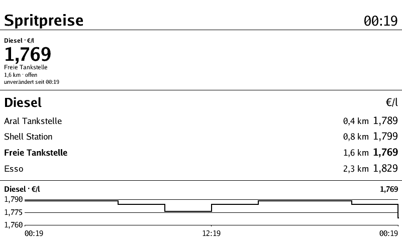
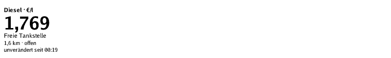
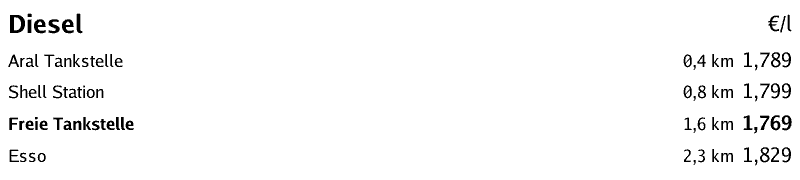
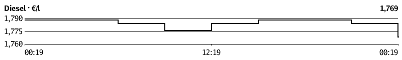

[← Plugins](README.md) · [Paperboy](../../README.md)

# fuel plugin

Fuel prices from [Tankerkönig](https://creativecommons.tankerkoenig.de). The
prices come from the German Markttransparenzstelle für Kraftstoffe (MTS-K) and
are published under [CC BY 4.0](https://creativecommons.org/licenses/by/4.0/).
The API needs a personal key.

## Screenshots

The example page `spritpreise` shows the cheapest station, the nearest stations
and the price history of the day:



| `cheapest` | `prices` | `history` |
|---|---|---|
|  |  |  |

## Configuration

| Key | Description |
|---|---|
| `apikey` | Required. Create it at <https://creativecommons.tankerkoenig.de>. |
| `lat`, `lon` | Required. The centre of the search. |
| `radius` | Search radius in km, default `5`, at most `25`. |
| `refresh` | How often the plugin fetches, default `10m`, at least `5m`. |
| `span` | How much price history the plugin keeps, default `168h` (one week), 1h to 168h. |
| `base` | Another Tankerkönig address. |

```yaml
plugins:
  fuel:
    config:
      apikey: ${TANKERKOENIG_API_KEY}
      lat: 52.52
      lon: 13.40
      radius: 5
```

**Demand:** Paperboy names the next moment a display needs the prices and the
plugin fetches then, never more often than `refresh`
([ADR 0126](../adr/0126-a-schedule-event-for-plugin-demand.md)). A page that no
display shows costs no request. The plugin requires Paperboy protocol 9.

**Terms of use:** the API allows one request per minute and a radius of at most
25 km. The plugin stays well below that with its minimum `refresh`. The
Tankerkönig terms exclude mineral oil companies and station operators. The
plugin names Tankerkönig in its title and in this page, as the licence asks.

## Widgets

All widgets are for image displays.

- `prices`: the nearest stations with name, distance and price. The heading
  names the fuel and the unit. The cheapest open station is bold. A closed
  station carries `closed`. Args: `fuel` (`diesel`, `e5`, `e10`; default
  `diesel`) and `stations` (1 to 10).
- `cheapest`: one large price with the station, the distance, the open state
  and since when the price holds. Args: `fuel`.
- `history`: the cheapest price as a stair line. The left axis names the lowest
  and the highest price, the lower edge the time. Args: `fuel` and `span` (1h to
  168h, default `24h`). Without stored points the widget says `No history yet`.

A price of a closed station counts only when no station with that fuel is open.
The widgets and the history use the same rule, so the chart ends at the price
of `cheapest`.

## Values

A text page reads these values
([ADR 0111](../adr/0111-text-pages-from-plugin-values.md),
[0120](../adr/0120-arguments-for-values.md)). All values but `updated` read the
argument `fuel`; `list` also reads `stations`.

| Value | Type | Unit | Precision | Meaning |
|---|---|---|---|---|
| `price` | number | €/l | 3 | cheapest price |
| `station` | text | | | name of the cheapest station |
| `distance` | number | km | 1 | distance to the cheapest station |
| `open` | text | | | open or closed, in the global language |
| `list` | text | | | one line per station: name, price, distance |
| `updated` | timestamp | | | time of the last fetch |

`paperboy` formats the numbers and the timestamps; the plugin never pads or
aligns them.

## History

The plugin samples the cheapest price of each fuel at every fetch and stores
the moment the price changes. A series is therefore small: a few points per
day. The plugin keeps one point before `span` as the start of the line.

Paperboy stores the series in `state/plugins/<id>/state.json`
([ADR 0081](../adr/0081-plugin-state-over-the-protocol.md),
[ADR 0143](../adr/0143-a-fuel-price-plugin-with-its-own-history.md)). The state
carries a fingerprint of the key, the position and the radius. A change of one
of them discards the old series. A restart keeps the chart, and a gap in the
history stays visible as a flat line.

The [Tankerkönig archive](https://creativecommons.tankerkoenig.de) has the
official history as CSV files. The plugin does not read it, because it needs an
account and a repository clone.
