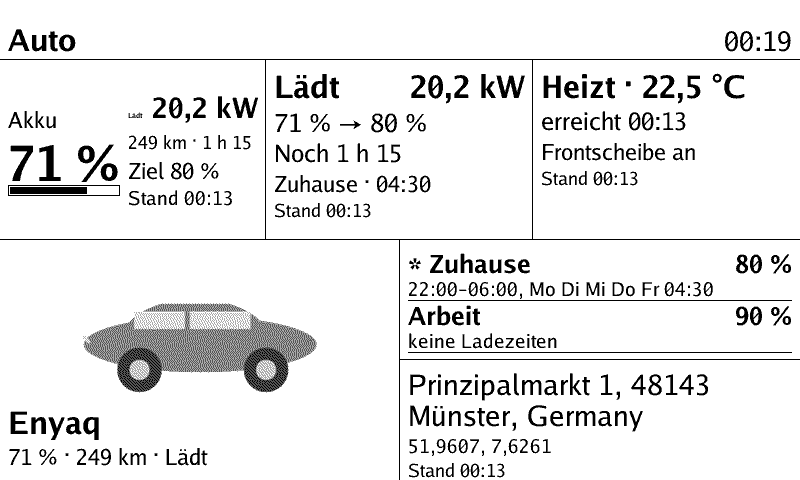
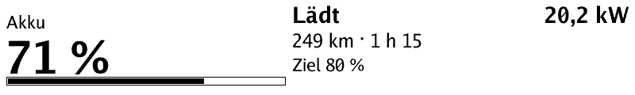
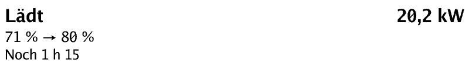
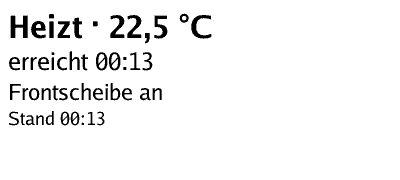
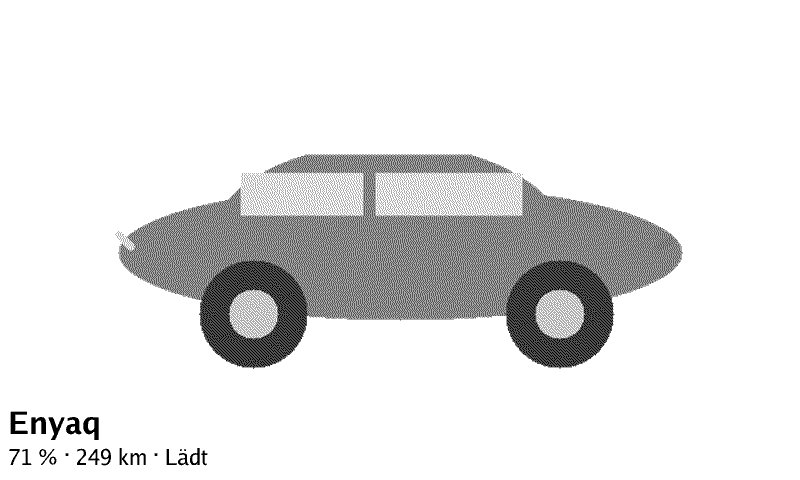
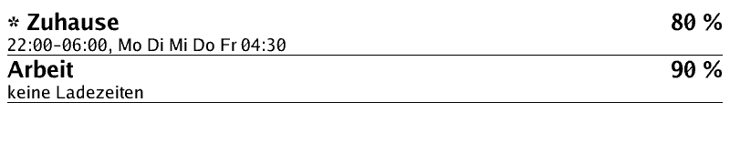
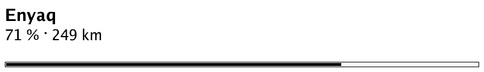

# myskoda plugin

Shows the state of a Škoda with a connected-vehicle subscription over the [MyŠkoda Public API](https://public.api.connect.skoda-auto.cz/docs). The plugin reads the vehicle in the background, keeps the last answer in memory and sends a change event when a shown value moves. It offers two actions: start and stop charging, and start and stop air conditioning (see [Actions](#actions)).

The API returns a snapshot: every part carries its own `carCapturedTimestamp`, so the widget shows when the car last sent its data. Parts a vehicle does not support are absent, and a field without a usable value is omitted — the widgets show `–` or leave the line out instead of inventing a value.

## Screenshots

The example pages `auto` and `auto.lcd2004` show the car on an image display
and on a 20 × 4 character display:



| `battery` | `charging` | `climate` | `card` |
|---|---|---|---|
|  |  |  |  |

| `profiles` | `location` | `car` |
|---|---|---|
|  |  |  |

The `auto` text page on a 20 × 4 display:

```text
Auto                
Akku 71 %     249 km
Lädt         20,2 kW
Heizt        22,5 °C
```

## Configuration

```yaml
plugins:
  myskoda:
    config:
      api_key: ${SKODA_API_KEY}
      vin: TMBJB9NY5RF999999
      refresh: 1h
```

| Key | Description |
|---|---|
| `api_key` | Required. API key created in the MyŠkoda app, bound to the vehicle. |
| `vin` | Required. Vehicle identification number, 17 characters. The API has no vehicle list. |
| `refresh` | Shortest interval between reads, default `1h`, at least `10m`; shorter values are raised to `10m` with one log line. The plugin reads only when a display needs the data ([ADR 0126](../adr/0126-a-schedule-event-for-plugin-demand.md)). |
| `base` | API base URL, default `https://public.api.connect.skoda-auto.cz`. |

**Rate limit:** the API allows 20 requests per hour and vehicle, commands included. The default of one request per hour leaves almost the whole quota free; a `429` is answered by waiting for `Retry-After` or `RateLimit-Reset`, and the last data stays on screen. A failing request is retried at the next interval, not in a loop.

**Demand:** Paperboy names the next moment a device needs the vehicle data and the plugin reads then, never more often than `refresh` ([ADR 0126](../adr/0126-a-schedule-event-for-plugin-demand.md)). Between those moments it idles and answers every request from the last state. A device that syncs every 30 minutes therefore still costs one read per hour, and a page that no display shows costs none. The plugin requires Paperboy protocol 9; an older host is refused with a clear error.

**Key expiry:** every answer carries `X-API-Key-Expires-At`. The plugin logs one line when less than seven days are left; an expired key (`401`, `api-key-expired`) fails the widgets with a notice that names the MyŠkoda app, because a key can only be created there — there is no refresh flow. A `403` (`api-key-not-authorized`) means the key does not cover this VIN.

**Restarts:** the plugin keeps what it needs between restarts as plugin state and a blob ([ADR 0081](../adr/0081-plugin-state-over-the-protocol.md), [what a plugin keeps](../design/05-plugins.md#what-a-plugin-keeps)): `state/plugins/myskoda/state.json` holds the last answer, when it was loaded, the next allowed attempt, the key expiry, a fingerprint of the key and the last error, and `state/plugins/myskoda/blobs/render.png` the vehicle image. Paperboy fills both from the plugin's answers and hands them back in the `state` request after a restart. A Paperboy restart within the refresh interval therefore costs no request and shows the last state at once, and a `429` with `Retry-After` stays in force across a restart. A changed VIN or API key, or state that cannot be read, discards it; the key itself is never written.

**Licence:** the MyŠkoda Public API is for personal use only. Commercial use, resale or redistribution is not allowed.

## Widgets

All widgets are for image displays; the values below give a text page the same data.

- `battery`: state of charge as a large number with a bar, range, charging state and power, remaining time or time of full charge, target state of charge, and the capture time. Args: `range` (default `true`).
- `charging`: charging state and power, state of charge against the target, remaining time, the current charging profile with its next charging time, capture time. Args: `profile` (default `true`).
- `profiles`: the saved charging profiles with target state of charge and their preferred charging times and timers. The current profile is marked with `*`. Args: `max` (default 2, 1 to 5).
- `location`: the formatted address, the coordinates, `PARKED` or `IN_MOTION` and the capture time. Args: `coords` (default `true`).
- `climate`: air conditioning state and target temperature, the expected time to reach it, window heating, auxiliary heating and active ventilation when they run, capture time.
- `card`: the vehicle render image dithered onto the display's gray levels (Floyd–Steinberg, like the Pokédex card) with the vehicle name and a state line (state of charge, range, charging state). Args: `name` (default `true`), `state` (default `true`). Image only.
- `car`: a compact overview for small cells: name, optional license plate, state of charge and range, charging state, lock state, odometer, and a state-of-charge bar. Args: `plate` (default `false`).

The render image comes from `info.renderUrl` and is downloaded once per URL, cached in memory and never committed; a missing image (`RENDER_UNAVAILABLE`) leaves the card without it instead of failing. The API key is not sent to the image host.

The charging state comes from `charging.status.state` and keeps short labels, because it shares a line with the power: `Getrennt` (`CONNECT_CABLE`), `Bereit` (`READY_FOR_CHARGING`), `Lädt`, `Erhaltung` (`CONSERVING`), `Entlädt` and `Unterbrochen` (`CHARGING_INTERRUPTED`); in English `Unplugged`, `Ready`, `Charging`, `Holding`, `Discharging`, `Interrupted`. An unknown value is shown as it is. Whether the cable is connected is already part of that state, so no widget repeats it from `plugConnectionState`.

## Values

A text page reads these values ([ADR 0111](../adr/0111-text-pages-from-plugin-values.md)); a value the API did not report becomes `–`:

| Value | Type | Unit | Precision | Meaning |
|---|---|---|---|---|
| `battery-soc` | number | % | 0 | state of charge |
| `battery-range` | number | km | 0 | remaining range |
| `charge-state` | text | | | charging state |
| `charge-power` | number | kW | 1 | charge power |
| `charge-remaining` | duration | | | time to full |
| `charge-target` | number | % | 0 | target state of charge |
| `car-name` | text | | | vehicle name, or the VIN |
| `license-plate` | text | | | license plate |
| `lock-state` | text | | | door lock state |
| `odometer` | number | km | 0 | odometer |
| `location` | text | | | parking address, or `Unterwegs`/`In motion` |
| `latitude`, `longitude` | number | ° | 5 | parking position |
| `climate-state` | text | | | air conditioning state |
| `climate-temperature` | number | °C or °F | 1 | target temperature, in the unit the car reports |
| `climate-reach` | timestamp | | | when the target temperature is reached |
| `profiles` | text | | | one line per charging profile: name, target and times |
| `captured` | timestamp | | | when the car sent its newest state |

## Actions

The plugin offers two actions ([ADR 0057](../adr/0057-plugin-actions-from-the-plan.md), [0164](../adr/0164-a-widget-action-carries-its-own-arguments.md), [0165](../adr/0165-a-plugin-describes-its-action-options.md)). A car widget binds one with `action: charging` or `action: climate`; leave `state` empty, so the device offers `start` and `stop` in its cell and a tap runs one. Both target a state instead of toggling, so a retried request is safe, and both ask for confirmation before they run; Paperboy ignores it in this version.

| Action | Args | Endpoint |
|---|---|---|
| `charging` | `state: start\|stop` | `POST /api/v1/vehicles/{vin}/charging/{start\|stop}` |
| `climate` | `state: start\|stop`, `temperature` (optional) | `POST /api/v1/vehicles/{vin}/air-conditioning/{start\|stop}` |

`temperature` is the target in °C, 16 to 30 in 0.5 steps; without it the car's current target is used, rounded to 0.5 °C. Air conditioning does not need a security PIN — only auxiliary heating does, and that command is not part of the plugin.

`action_options` returns `start` and `stop`. The target state that already holds is `active` and does not run. The other option is disabled when the vehicle does not list the command in `operations` or cannot run it. `start` charging needs a connected cable and no running charge; `stop` charging needs a running one. `start` air conditioning needs it to be off; `stop` needs it to run. No data disables the whole action. A `202` answer counts as success. Other errors (`403`, `422`, `429`) become a short message. After a successful command the plugin reloads the state at once and reports `changed`. Each command counts against the same 20 requests per hour as a read.

## Differences from the MyŠkoda app

The API also offers:

- further remote commands: charging limit, charge mode, charging profile updates, auxiliary heating (needs the security PIN `spin`) and active ventilation;
- fuel status for combustion and plug-in hybrid cars;
- door, window, sunroof and light detail, tire pressure is not part of the API.

Doors, windows and lights beyond the overall lock state, fuel status and those further commands are not implemented yet.
