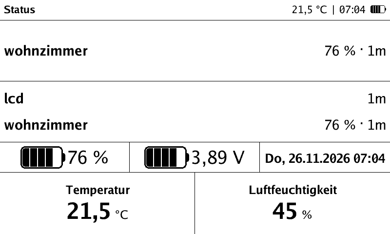
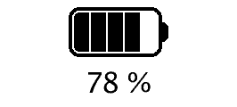
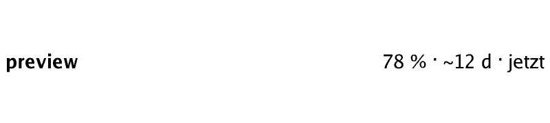

# paperboy plugin

The built-in plugin `paperboy` runs inside Paperboy and needs no configuration. Its widgets draw on image pages; its values feed text pages ([ADR 0111](../adr/0111-text-pages-from-plugin-values.md)).

## Screenshots

The example page `status` with the title and the room temperature in the
header band, the battery and clock at its right, two device-status rows, two
gauges and the room as large values:



| `battery` | `device-status` | `reading` |
|---|---|---|
|  |  |  |

| `text` | `clock` | `logo` |
|---|---|---|
|  |  |  |

The `hinweise` text page on a 20 × 4 display:

```text
Hinweise            
Datum 21.11.2026    
          Zeit 00:19
Jetzt          00:19
```

## Values

A text page lays out values ([ADR 0111](../adr/0111-text-pages-from-plugin-values.md)). The plugin declares:

| Value | Type | Content |
|---|---|---|
| `title` | text | the page title |
| `time` | timestamp | the current moment |
| `date` | timestamp | midnight of the current day, so Paperboy writes the date |
| `now` | timestamp | the current moment, for a layout test |
| `long` | text | a line wider than a 20-column display, for `overflow: scroll` |
| `block` | text | four lines, one with a very long word, for `overflow: wrap` |
| `temperature` | number, °C, one decimal | the room temperature the device measures |
| `humidity` | number, %, no decimal | the room humidity the device measures |

```yaml
cells:
  - { at: [0, 0], span: [20, 1], value: paperboy/title }
  - { at: [0, 1], span: [20, 1], value: paperboy/date, label: Datum }
  - { at: [0, 2], span: [20, 1], value: paperboy/time, label: Zeit, align: right }
  - { at: [0, 3], span: [20, 1], value: paperboy/temperature, label: Raum }
```

The readings come from the device that renders the page, so two displays of the same text page show their own rooms. A device without a sensor has no value, and the cell shows its notice ([ADR 0134](../adr/0134-readings-from-the-device.md), [0163](../adr/0163-the-readings-in-the-device-status-and-a-reading-widget.md)).

## Header band

Every image display type has a header band outside the grid
([ADR 0167](../adr/0167-a-header-band-outside-the-page-grid.md),
[0168](../adr/0168-a-header-band-per-display-type.md)). The band is fixed
chrome, not a list of widgets:

```yaml
header:
  height: 24
  page_indicator: true   # default true
  temperature: true
  humidity: true
  clock: time            # time, date, datetime or none
  battery: true
```

The title and its page indicator sit on the left. The right group is
right-aligned and holds the room temperature, the humidity, the clock and the
battery, in that order from left to right. A pipe separates the temperature,
the humidity and the clock. The page indicator follows the title after one
space. All text uses one size; only the
title is bold. The battery shows its gauge without a percentage. The grid below the
band starts at `cells` row 0. A page hides the band with `header: false`; a
text display type has no header band. The band is one internal widget; a page
does not place it.

## Widgets

- `battery`: the battery of one device as a gauge with a label. Args: `device` (id; default the device that shows the page), `label` (`auto`, `percent`, `volts` or `none`, default `auto`: the percentage, otherwise the voltage) and `align` (`left`, `center` or `right`, default `center`). Spans: `1x1`, `2x1` and `3x1` put the value beside the gauge, `2x2` puts it below the gauge ([ADR 0121](../adr/0121-segmented-battery-gauge.md)). The gauge fills the cell height. It is the shared battery gauge of the design language ([ADR 0166](../adr/0166-a-shared-battery-gauge.md)): a rounded, thick outline, a narrow cap that sits flat on the body, and four or five segments, so 84 % and 100 % differ at a glance. The fill follows the rounded inner wall. While the device charges below 100 %, the body is empty and a bolt stands over it; at 100 % the full gauge returns ([ADR 0173](../adr/0173-a-charging-mark-over-an-empty-battery.md)). A slash marks a missing reading instead of an empty outline, and `-` replaces the value. A `warn` or `critical` level thickens the outline. The value shrinks to keep the gauge, and it wins when the cell is too narrow for both.
- `device-status`: one row per device with battery, estimated runtime and the time since the last contact. Args: `devices` (ids; default the device that shows the page), `battery`, `runtime` and `seen` (each `bool`, default `true`). A device that is overdue carries `!`; a device that never contacted Paperboy or has no device file carries `?`. The stalest device comes first.
- `reading`: one measured value of a device, for example the room temperature. Args: `name` (`temperature` or `humidity`, default `temperature`; the keys of the reading catalog), `device` (id; default the device that shows the page), `label` (default `false`: the catalog title above the value, e.g. „Temperatur“), `unit` (default `true`), `age` (default `true`: the time since the measurement in the caption once it is older than an hour) and `align` (`left`, `center` or `right`, default `center`). Spans: `1x1`, `2x1`, `3x1` and `3x2`; a short cell drops the label before the value. The number and the label follow the page language, so a German page writes „21,5 °C“. A device without the reading shows „keine Messung“ in its cell ([ADR 0163](../adr/0163-the-readings-in-the-device-status-and-a-reading-widget.md)).
- `text`: fixed text. Args: `text` (with `\n` for line breaks; a real line break works too, and one trailing line break adds no empty line), `align` (`left`, `center` or `right`, default `center`), `size`, `bold`.
- `clock`: the current time. Args: `format` (`time`, `date`, `datetime` or `auto`, default `time`) and `align` (`left`, `center` or `right`, default `center`). `auto` takes the longest date form that fits and adds the time; it fits the header band.
- `logo`: the Paperboy mark — the page of four by three cells with one cell drawn and the top-right corner turned down ([docs/logo](../logo/README.md)) — centered in the cell and as large as the cell allows. Arg `wordmark` (default `false`) adds the wordmark in Go Mono Bold, so the cell shows the lockup. Image displays only.

```yaml
- { at: [0, 0], span: [4, 3], widget: paperboy/logo, args: { wordmark: true } }
- { at: [0, 1], span: [6, 2], widget: paperboy/device-status }
- { at: [0, 3], span: [6, 2], widget: paperboy/device-status, args: { devices: [wohnzimmer, flur] } }
- { at: [0, 5], span: [2, 2], widget: paperboy/battery }
- { at: [2, 5], span: [2, 1], widget: paperboy/reading, args: { label: true } }
- { at: [4, 5], span: [2, 1], widget: paperboy/reading, args: { name: humidity } }
```

Arguments with a fixed set of values reject anything else ([ADR 0055](../adr/0055-allowed-arg-values-and-gallery-form.md)); the Playground offers them as choices. The page editor offers the configured device ids for `battery.device`, `device-status.devices` and `reading.device`, and names the empty choice *the device that shows the page* ([ADR 0123](../adr/0123-a-sample-device-in-previews.md)).

The battery, `device-status`, `reading` and the header band read `server_status` from the request (ADR 0115, 0167). Only the built-in plugin gets this object; Paperboy keeps no key, MAC or address in it. The page that shows its own device is rendered once per device, so two displays of the same type keep their own status. A preview without a device shows the sample device `preview` with fixed values, 78 %, 4.05 V, not charging, a runtime of about 12 days, 21.5 °C and 45 % ([ADR 0123](../adr/0123-a-sample-device-in-previews.md)).

A text page shows these values, not widgets ([ADR 0118](../adr/0118-text-boxes-and-overflow.md)). A box that scrolls takes its content from a value and moves it with the display type's `scroll.step`; a box that wraps or strips cuts it instead.
