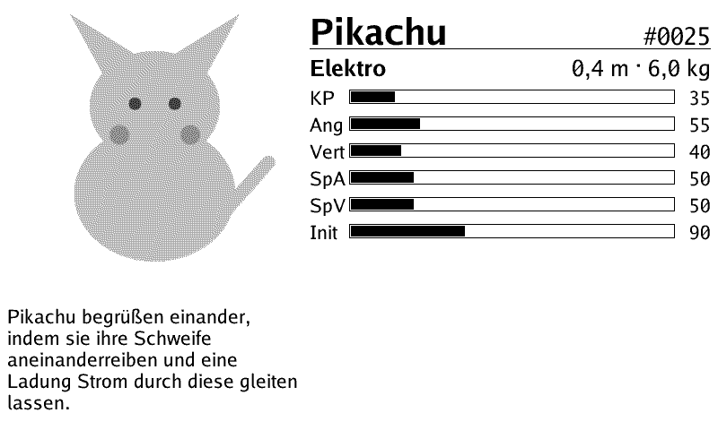

# pokedex plugin

Pokémon from [PokéAPI](https://pokeapi.co), no API key needed.

## Screenshots

The example page `pokemon` with a full-screen card:




The picture above is drawn by the screenshot generator. The repository ships
no sprite or artwork of a Pokémon.

## Configuration

| Key | Description |
|---|---|
| `pokemon` | Name or national dex number |
| `mode` | `fixed` (the default when `pokemon` is set) or `random` |
| `rotate` | How often a random Pokémon changes, default `24h`, at least `1h`; aligned to local midnight and stable across restarts |
| `generations` | List of generations 1 to 9, e.g. `[1, 2, 3]`; limits the random pick |
| `base` | Another PokéAPI address |

**Demand:** Paperboy names the next moment a display needs the card and the plugin loads it then ([ADR 0126](../adr/0126-a-schedule-event-for-plugin-demand.md)). `rotate` still decides when a random Pokémon changes; a page that no display shows costs no request. The plugin requires Paperboy protocol 9.

## Widget `card`

The card is for image displays. It shows the artwork, the name in the request language (from the species names, with English as fallback), the number, types, height and weight, the six base stats as bars and the flavor text in the request language. Two arguments leave the stats or the flavor text out.

Without the stats the artwork takes the cell's full height on the left, and the text takes the column on the right. A narrow column puts the size below the types. A cell that is not wide enough stacks: the header spans the width and the artwork follows underneath, centered. The header never grows beyond the base text size, and a text block that does not fill its column is centered. With the stats the artwork stays left of the text on a wide cell and above it on a tall one. The artwork stays the main part; on a short cell the flavor text gives back a line.

Arguments:

| Key | Description |
|---|---|
| `seed` | Any label, e.g. the name of a device. Every seed draws its own random Pokémon, all of them from the same rotation interval |
| `stats` | Draw the six base stats as bars, default `true` |
| `flavor` | Draw the flavor text when there is room, default `true` |

Without a seed every use of the plugin shows the same Pokémon. With a seed the pick depends on the rotation interval and the seed, so it stays stable across restarts and still changes at the same moment for all seeds.

The argument lives in the page, and Paperboy composes a page per display type rather than per device. Two devices of the same type therefore show the same card until they use different pages:

```yaml
cells:
  - { at: [0, 0], span: [6, 8], widget: pokedex/card, args: { seed: kueche } }
```

Each distinct seed of a request costs one Pokémon (a handful of requests to PokéAPI) per rotation.

The plugin downloads the artwork at runtime and reduces it to the display's gray levels with error diffusion; it is never stored or shipped. It caches responses in memory, sends requests one at a time with a pause between them, and reports a change when the Pokémon rotates.

## Values

A text page reads these values ([ADR 0111](../adr/0111-text-pages-from-plugin-values.md), [0120](../adr/0120-arguments-for-values.md)). The argument `seed` picks the Pokémon like the card's `seed`; without it they describe the default seed.

| Value | Type | Unit | Precision | Meaning |
|---|---|---|---|---|
| `name` | text | | | name in the request language |
| `number` | number | | 0 | national dex number |
| `types` | text | | | types, separated by `/` |
| `height` | number | m | 1 | height |
| `weight` | number | kg | 1 | weight |
| `hp`, `attack`, `defense`, `special-attack`, `special-defense`, `speed` | number | | 0 | base stats |
| `flavor` | text | | | flavor text in the request language |

Pokémon and their artwork belong to Nintendo, Game Freak and The Pokémon Company. The plugin only fetches them for private display.
