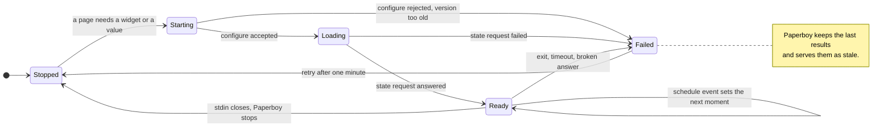

# Plugin protocol

Paperboy and its plugins talk over standard input and standard output, one
JSON object per line ([ADR 0049](../adr/0049-plugin-widgets.md)). This document is the reference for the wire
format; the Go types live in [`sdk/plugin`](../../sdk/plugin/plugin.go).

- Current version: **10** ([ADR 0050](../adr/0050-physical-scaling-by-display-ppi.md) added version 3, [ADR 0057](../adr/0057-plugin-actions-from-the-plan.md) added
  actions, [ADR 0081](../adr/0081-plugin-state-over-the-protocol.md) added plugin state and blobs and made 5 the minimum,
  [ADR 0111](../adr/0111-text-pages-from-plugin-values.md) added values,
  [ADR 0125](../adr/0125-remove-the-text-widget-path.md) removed the text action,
  [ADR 0126](../adr/0126-a-schedule-event-for-plugin-demand.md) added the schedule event,
  [ADR 0127](../adr/0127-plan-conditions-are-values.md) added the `enum` value type and removed conditions,
  [ADR 0165](../adr/0165-a-plugin-describes-its-action-options.md) added the action options).
  From version 5 on the protocol grew additively. Version 8 removed the text action. Version 9 adds an inbound event and the `enum` value type, and removes the conditions of version 6. Version 10 adds the `action_options` request with the `active` flag. Paperboy keeps the floor at 5: a plugin below 8 that still has text widgets is accepted, because nothing asks it for text.
  `server_status` is additive and keeps version 6
  ([ADR 0115](../adr/0115-device-status-in-a-widget.md)).
- Paperboy starts a plugin on first use and keeps it running.
- Paperboy writes one request line; the plugin writes exactly one answer line
  with the same `id`. Between answers the plugin may write events without an
  `id`.
- The plugin exits when standard input closes.
- Unknown request or answer fields must be ignored, so later additions stay
  compatible.

## Lifecycle

The host runs a plugin in four states: stopped, starting, ready and failed.
It keeps one process per plugin.



- **Starting** sends `configure` once. Paperboy sends the plugin its section of
  `paperboy.yaml`.
- **Loading** sends `state` with the stored state and blobs. A plugin gets its
  data back before the first widget request ([ADR 0081](../adr/0081-plugin-state-over-the-protocol.md)).
- **Ready** answers the requests of a page: `describe`, `render`, `values`,
  `actions`, `action_options` or `action`. One request per plugin runs at a
  time.
- **Failed** means the process exited, a request timed out or the answer was
  invalid. Paperboy kills a hanging process after `timeout` (default 30 s).
  The last results stay as stale in the widget cache. The host asks a failed
  plugin again after one minute.
- A plugin without a version or below version 5 fails at its first answer
  ([ADR 0058](../adr/0058-plugin-protocol-version-check.md)). A newer version is
  accepted, because the protocol only grows.
- A change of the plugin configuration replaces the process on its next
  request. Paperboy reads the state files before `configure`, so the new
  process gets the same state.
- A `changed` event is no request and needs no answer. It drops the named
  results, or all results of the plugin. The `schedule` event sets the next
  moment the host needs data; it also needs no answer.

## Requests

Every request carries:

| Field | Meaning |
|---|---|
| `id` | Request identifier; the answer repeats it |
| `version` | Protocol version, currently `10` |
| `action` | `configure`, `state`, `describe`, `render`, `values`, `actions`, `action_options` or `action` |
| `language` | `"de"` or `"en"` |
| `timezone` | IANA name such as `Europe/Berlin` |
| `now` | Time of the request, RFC 3339 |
| `page` | `title`, `number` (1-based), `count`, display `width`/`height`, and `ppi` for image displays |
| `widgets` | For `render`: the widgets to draw |
| `values` | For `values`: the declared value keys the page needs |
| `actions` | For `actions`, `action_options` and `action`: the concrete actions |
| `device` | For `actions`, `action_options`, `action` and `values`: `id`, `name`, `hardware`; absent for a preview |
| `server_status` | For `render`, built-in plugin only: `current_device_status` and `selected_devices_status` (ADR 0115) |
| `levels` | For `render`: gray levels of the display, 1–256; the canvas falls back to 2, 4 or 16 tones |
| `config` | For `configure`: the plugin's section of `paperboy.yaml` |
| `state` | For `state`: the JSON object the plugin stored last time; missing when there is none ([ADR 0081](../adr/0081-plugin-state-over-the-protocol.md)) |
| `blobs` | For `state`: the stored blobs by name, base64 in JSON ([ADR 0081](../adr/0081-plugin-state-over-the-protocol.md)) |

### `configure`

The first request after the start, once. `config` is the plugin's section of
`paperboy.yaml` with `${VAR}` already expanded from the environment. A plugin
rejects unknown keys and missing required keys, usually with
`Values.Check`. An error answer stops the plugin; Paperboy reports the error in
the cells that use it.

```json
{"id":"1","version":5,"action":"configure","language":"de","timezone":"Europe/Berlin","now":"2026-11-07T12:00:00+01:00","config":{"lat":52.5,"lon":13.4}}
```

### `state`

Sent once, right after a successful `configure`. It carries `state` (the
stored object) and `blobs`
(the stored files), so the plugin has its data before the first widget
request. The answer may return `state` and `blobs` to store; an empty answer is
enough.

```json
{"id":"2","version":5,"action":"state","language":"de","timezone":"Europe/Berlin","now":"2026-11-07T12:00:00+01:00","state":{"fetched_at":"2026-11-07T11:00:00Z"},"blobs":{"render.png":"iVBORw0…"}}
```

### `describe`

Answers with `description`. It feeds `GET /api/plugins`, the Playground,
the page editor and the choices of a widget action.

```json
{
  "id": "2",
  "description": {
    "title": "evcc",
    "version": "1.2.0",
    "widgets": [
      {
        "widget": "site",
        "title": "Site",
        "kinds": ["image"],
        "sizes": [{"columns": 3, "rows": 3}],
        "args": {"short": {"type": "bool", "default": false}}
      }
    ],
    "values": [
      {
        "name": "pv",
        "title": "PV power",
        "type": "number",
        "unit": "W",
        "precision": 0,
        "progression": [
          {"unit": "kW", "factor": 1000, "precision": 1},
          {"unit": "MW", "factor": 1000000, "precision": 2}
        ]
      }
    ],
    "actions": [
      {
        "name": "mode",
        "title": "Charge mode",
        "args": {"mode": {"type": "string", "required": true, "enum": ["now", "off"]}},
        "confirm": {"required": true, "text": "Switch the charge mode?"}
      }
    ],
    "config": {"url": {"type": "string", "required": true}},
    "blobs": ["render.png"]
  }
}
```

- `widgets[].kinds` is `image`. A widget is for an image display; text pages read values ([ADR 0111](../adr/0111-text-pages-from-plugin-values.md), [ADR 0125](../adr/0125-remove-the-text-widget-path.md)).
- `values[]` declares the data a text page can lay out ([ADR 0111](../adr/0111-text-pages-from-plugin-values.md), [0120](../adr/0120-arguments-for-values.md), [0122](../adr/0122-hide-and-progress-a-unit.md)): `name`, `title`, `type`, `unit`, `precision`, `progression`, `kind` and `args`.
  `type` is `number`, `text`, `duration`, `timestamp`, `direction` or `enum`. `unit` is the base unit the plugin answers a number in, and `precision` its number of decimals.
  An `enum` value declares its allowed keys in `enum`, e.g. `["normal", "low", "high", "urgent"]`; the plugin answers one key and Paperboy rejects any other. The declaration carries no labels: a text cell labels the keys it shows ([ADR 0127](../adr/0127-plan-conditions-are-values.md)).
  A plan condition names an enum value and its matching keys. Paperboy sends an ordinary values request before it selects a page; the plugin does not see the plan.
  `progression` names the larger units Paperboy may use, each with its `factor` to the base unit and its `precision`; an empty or missing list keeps the base unit. The plugin always answers in the base unit.
  `kind` is `value` (default) or `list`; protocol 7 answers only single values. A value is data, not text: the plugin never pads or formats it.
  `args` uses the same [argument schema](#arguments) as a widget; an empty or missing map means the value reads none.
- `version` is the plugin's own version, matching the `-v<version>` of its program name ([ADR 0075](../adr/0075-plugin-versions.md)). It is optional; Paperboy compares it with the file name and logs one warning when they differ.
- `widgets[].sizes` are spans of the 6 × 8 reference grid, hints for an editor. Paperboy maps them onto the page grid when it places a cell ([ADR 0128](../adr/0128-a-default-grid-per-display-type.md)).
- `args` use the same [argument schema](#arguments) as configuration keys.
- `actions[].name` is the action name without the plugin prefix. A plan
  references it as `plugin/name`.
- `confirm` is optional. `required: true` makes the device ask before running
  the action; `text` overrides Paperboy's generic confirmation text.
- A plugin without actions omits `actions` or sends an empty list.
- `blobs` names the files the plugin keeps besides its state, such as a
  downloaded image ([ADR 0081](../adr/0081-plugin-state-over-the-protocol.md)). Paperboy logs files below `blobs/` that the
  plugin does not declare.

### `render`

`render` draws each widget on a canvas of exactly `width` × `height` pixels
with `levels` gray levels and returns a PNG. A text page of values does not use
widgets ([ADR 0111](../adr/0111-text-pages-from-plugin-values.md)); version 8 removed the text action
([ADR 0125](../adr/0125-remove-the-text-widget-path.md)). Widgets get their
arguments in `args` and the page's look in `style`:

| `style` field | Meaning |
|---|---|
| `padding` | Inner margin in pixels |
| `rule` | Width of separator lines in pixels, at least 1 |
| `text_px` | Base text height in pixels |

Paperboy converts the page's points to pixels with the display's `ppi`
([ADR 0050](../adr/0050-physical-scaling-by-display-ppi.md)). A widget never draws on a text display; text pages read values instead.

```json
{"id":"3","version":5,"action":"render","levels":4,"page":{"title":"Overview","number":1,"count":3,"width":800,"height":480,"ppi":125},"widgets":[{"widget":"site","width":400,"height":240,"args":{"short":true},"style":{"padding":8,"rule":1,"text_px":28}}]}
```

```json
{"id":"3","widgets":[{"png":"…base64…"}],"max_age":300}
```

An answer carries one result per widget, in the request's order. A widget that
fails sets `error`; the other widgets still draw. Paperboy draws the error as a
hatched notice in the widget's cell, so a widget must report a cell it cannot
draw in instead of leaving it blank: `plugin.TooSmall(w)` wraps
`plugin.ErrTooSmall` with the cell's pixel size and reads
`cell too small: 800x180`. `max_age` (seconds) tells Paperboy how long it may
reuse the results; `0` means its default of five minutes.

### `values`

Answers the values of a text page ([ADR 0111](../adr/0111-text-pages-from-plugin-values.md), [0120](../adr/0120-arguments-for-values.md)). One request covers every key of the page that belongs to this plugin and has the same arguments. It carries the usual `page`, optional `device`, `language`, `timezone` and `now`, the names in `values` and their arguments in `value_args`.

```json
{"id":"7","version":7,"action":"values","language":"de","timezone":"Europe/Berlin","now":"2026-11-15T12:00:00+01:00","device":{"id":"kueche"},"page":{"title":"Werte","number":1,"count":1,"width":20,"height":4},"values":["stop","next"],"value_args":{"stop":"Rathaus"}}
```

```json
{"id":"7","version":7,"values":{"stop":{"text":"Bielefeld, Rathaus"},"next":{"text":"4 Sieker 3"}},"max_age":60}
```

- The answer is a map from the requested name to one value. Exactly one field carries the value:
  `{"number": 12.5}`, `{"text": "…"}`, `{"duration": 3600}` in seconds, `{"timestamp": "2026-11-15T12:00:00+01:00"}` in RFC 3339, `{"direction": 1}` with 1 up, 0 flat and -1 down, or `{"enum": "low"}` with one key of the declaration.
- An enum value may answer an empty object, `{}`, when it has no key now, such as a stale reading. A plan condition does not match then, and a text cell shows `?`.
- A missing name is an error for that cell; Paperboy shows a `? …` cell. The other values still reach the page.
- `value_args` holds the arguments of every name in `values`; a value without arguments omits the field. The plugin checks them with `plugin.Values.Check`, like a widget's arguments.
- Paperboy sends one request per plugin and argument set, so two boxes with different arguments are two requests. The cache holds them separately.
- `max_age` works like for widgets: it tells Paperboy how long it may reuse the answer, and a `changed` event drops it.
- A plugin that does not declare a requested name is not asked; the cell shows the error instead.
- Paperboy formats the value: a number with the precision of its chosen step and the global language, a duration, a timestamp or a direction. A number with a progression takes the largest step whose rounded absolute value is at least 1, unless the cell forces a step. The plugin decides neither width nor alignment.
- A text value may carry several lines, one per record, such as an agenda or a list of departures. Paperboy shows them line by line; the label opens the first line and the unit closes the last. List values with named fields arrive in a later version.

### `server_status`

`server_status` is Paperboy's privileged view of its devices (ADR 0115). Only
the built-in plugin receives it; every other plugin gets no field, because its
cached widgets would show stale rows. The object carries no key, no MAC and no
address.

```json
{
  "server_status": {
    "current_device_status": {
      "id": "kueche",
      "display": "sticky",
      "plan": "standard",
      "status": "ok",
      "last_seen": "2026-11-15T09:04:30+01:00",
      "seen_s": 30,
      "power": "battery",
      "battery": {"volts": 3.75, "percent": 84, "charging": false},
      "readings": {"temperature": {"value": 21.5, "taken": "2026-11-15T09:04:30+01:00"},
                   "humidity": {"value": 45, "taken": "2026-11-15T09:04:30+01:00"}},
      "runtime_s": 1036800,
      "runtime_span_s": 172800
    },
    "selected_devices_status": {
      "wohnzimmer": {"id": "wohnzimmer", "status": "late", "seen_s": 7440}
    }
  }
}
```

- `current_device_status` is the device the page is rendered for; it is
  missing in a preview without a device.
- `selected_devices_status` is a map from id to status. It holds only the
  devices a page names in its widget arguments, not every configured device.
  An id that no device file has appears with `status: "unknown"`.
- `status` is `ok`, `late`, `never`, `unregistered` or `unknown`.
- `battery` carries `volts`, `percent`, `mah`, `ma`, `charging` and `level`
  (`warn` or `critical`). `runtime_s` is the estimated battery runtime; `0`
  means no estimate or a mains device.
- `readings` maps a key of Paperboy's reading catalog to the last measured value
  and the moment it was taken ([ADR 0134](../adr/0134-readings-from-the-device.md),
  [0163](../adr/0163-the-readings-in-the-device-status-and-a-reading-widget.md)).
  The value is a bare number in the catalog's unit; a device without a reading
  has no key. The field is additive and does not change the protocol version,
  because only the built-in plugin receives `server_status` (ADR 0115).

### `actions`

Reports the current state of the concrete actions, one answer per call, in the
request's order.

```json
{"id":"4","version":5,"action":"actions","language":"de","timezone":"Europe/Berlin","now":"2026-11-07T12:00:00+01:00","device":{"id":"kueche","name":"Kitchen","hardware":"sticky"},"page":{"title":"Overview","number":1,"count":3,"width":800,"height":480,"ppi":125},"actions":[{"action":"mode","args":{"mode":"now"}},{"action":"refresh"}]}
```

```json
{"id":"4","actions":[{"title":"Charge now"},{"title":"Refresh","disabled":"evcc is offline"}],"max_age":60}
```

- `title` overrides the spec's title for this instance.
- `disabled` is the reason why the action cannot run now; empty means
  available. A disabled action carries the reason instead of disappearing.
- `confirm` overrides the spec's confirmation for this instance.
- The plugin validates `args` itself against the spec; a bad value becomes a
  `disabled` reason instead of a protocol error. `Values.Check` does both the
  unknown-key and the enum check.
- The number of states must match the number of calls. A mismatch or an error
  answer disables all actions of that plugin until the next successful answer.

### `action_options`

Describes the complete options of the concrete actions, one option set per
call, in the request's order ([ADR 0165](../adr/0165-a-plugin-describes-its-action-options.md)).
The action view of a widget uses it.

```json
{"id":"6","version":10,"action":"action_options","language":"de","timezone":"Europe/Berlin","now":"2026-11-25T12:00:00+01:00","device":{"id":"kueche","hardware":"e1001"},"actions":[{"action":"mode","args":{"index":0}}]}
```

```json
{"id":"6","options":[{"title":"Lademodus","options":[{"args":{"index":0,"mode":"pv"},"title":"PV","active":true},{"args":{"index":0,"mode":"now"},"title":"Jetzt","disabled":"Kein Kabel verbunden"}]}]}
```

- `args` of an option is the complete call for the following `action` request.
  The plugin honors every argument the call already fixes and returns only the
  options that remain.
- `title` labels an option and follows the request's `language`. An empty title
  falls back to the action's title.
- `active` marks the current option. Paperboy draws it as the current tile and
  does not run it. At most one option is active; a second one is a plugin fault
  and Paperboy logs it.
- `disabled` is the reason an option cannot run now. Paperboy hatches the tile.
  An active option and a disabled option never run a call.
- A `disabled` reason at the set level, with no options, keeps the cell visible
  with the reason. An empty option list without a reason is a plugin fault.
- The plugin flattens multiple dimensions into one list. Paperboy does not group
  or combine options.
- The request needs protocol 10. Paperboy asks it only of a plugin that reports
  version 10 or newer; an older plugin keeps the `actions` path of
  [ADR 0162](../adr/0162-widget-actions-and-the-plugins-choices.md).
- The number of option sets must match the number of calls.

### `action`

Runs exactly one concrete action. Paperboy sends one `actions` entry.

```json
{"id":"5","version":5,"action":"action","language":"de","timezone":"Europe/Berlin","now":"2026-11-07T12:00:00+01:00","device":{"id":"kueche","hardware":"sticky"},"page":{"title":"Overview","number":1,"count":3,"width":800,"height":480,"ppi":125},"actions":[{"action":"mode","args":{"mode":"now"}}]}
```

```json
{"id":"5","result":{"ok":true,"message":"Charging now","changed":true}}
```

- `ok: false` with a `message` means the action ran but failed; Paperboy shows
  the message.
- A protocol or plugin failure is an `error` answer instead.
- `changed: true` tells Paperboy to drop the plugin's cached widgets before the
  next render.
- Actions should set a target state (`mode: now`), never toggle, so a retried
  request is safe.

## Answers and events

An answer carries `id`, its `version` and optionally `error`, plus the payload
for its request: `widgets`, `values`, `actions`, `options`, `result`,
`description` or `max_age`.
`Handle` fills `version` with the protocol version the plugin was built
against, in every answer and in the `changed` event. Paperboy calls
`Message.CheckVersion` on every answer and refuses the plugin when the version
is missing or older than 5 ([ADR 0058](../adr/0058-plugin-protocol-version-check.md), [ADR 0081](../adr/0081-plugin-state-over-the-protocol.md)); newer versions are accepted,
because the protocol only grows additively. The cells show the error
and the plugin is dropped with one log line. Plugins written by hand in another
language must print the field themselves.

An answer may also carry `state` and `blobs` to store (see [state between
restarts](#state-between-restarts)).

An event has no `id`:

```json
{"event":"changed","changed":["agenda"]}
```

`changed` invalidates the named widgets, or all widgets of the plugin when the
list is empty or missing. Plugins must send it when action-relevant state
changes; for widgets with actions, a threshold on a number is not enough.

An event may carry `state` and `blobs` as well, and a line with only `state`
stores it without touching the widget cache.

## Events from Paperboy

Paperboy may send a line without `id` to a running plugin. Version 9 adds the
schedule ([ADR 0126](../adr/0126-a-schedule-event-for-plugin-demand.md)):

```json
{"event":"schedule","next_refresh":"2026-11-16T18:00:00+01:00"}
{"event":"schedule"}
```

- `next_refresh` names the next moment Paperboy needs the plugin's data.
  Missing or null means no display needs it now.
- Paperboy sends the event when the plugin starts and when the moment changes
  by more than about a minute.
- It sends it only to a plugin that reports version 9 or newer, so an older
  plugin never sees a line it does not understand.
- A plugin ignores events it does not know.
- `sdk/plugin.Demand` receives the event. `Wait(ctx, floor)` sleeps until
  `next_refresh` minus 30 seconds, wakes on a new schedule, and never returns
  earlier than `floor` after the call. A plugin calls it after each fetch, so
  the floor counts from the end of the fetch. With no demand it blocks.
- A plugin that uses the schedule requires Paperboy 9 or newer. It checks the
  request `version` and refuses an older host; otherwise it would idle forever.
  The reverse still works: Paperboy 9 accepts an older plugin, which ignores the
  event.

## Arguments

`Arg` describes one widget argument, action argument or configuration key:

| Field | Meaning |
|---|---|
| `type` | `string`, `int`, `float`, `bool`, `duration` or `list` |
| `default` | Default value |
| `required` | The key must be set |
| `description` | Help text for an editor |
| `enum` | Allowed values, or allowed elements of a list ([ADR 0055](../adr/0055-allowed-arg-values-and-gallery-form.md)) |
| `enum_labels` | Display text per enum value, keyed by `fmt.Sprint` of the value; the stored value stays the key |

`Values.Check(known)` rejects unknown keys, missing required keys and values
outside `enum`. `Values.CheckEnums(known)` only checks the enums and leaves
unknown keys alone; `Handle` applies it per widget before calling `Render` or
`Text`. `describe` is answered on demand, so a plugin may compute `enum` from
the data it has loaded; the calendar plugin offers the discovered calendar
names as check boxes. Paperboy validates against the answer current at that
moment.

## State between restarts

A plugin process ends when it exits, when a request times out, and when its
configuration changes; Paperboy itself restarts on every deployment. Everything
a plugin keeps in memory is lost then, and Paperboy's widget cache is no help
because it holds drawn results, not data.

State is part of the protocol ([ADR 0081](../adr/0081-plugin-state-over-the-protocol.md)). Paperboy keeps it, a protocol 5
plugin never writes a file. Paperboy reads the stored state before `configure`,
so an answer to `configure` cannot replace it. A plugin starts its background
work after the `state` request and sees the restored state there.

- **`state`** is a JSON object of at most 256 KiB. The `state` request carries
  the stored one; every answer and event may send a new one. A missing `state`
  field means unchanged, `state: null` forgets it. A plugin returns the whole
  object, not a diff.
- **`blobs`** are larger values, such as a downloaded image. `describe`
  declares their names, the `state` request carries the stored ones
  base64-coded, and any answer or event may write changed ones. A blob is at
  most 1 MiB; a plugin keeps at most four.

Paperboy stores them in the plugin's directory, `<instance>/state/plugins/<id>/`:
`state.json` and `blobs/<name>`, both readable by the owner only. A file a
plugin no longer declares stays until the operator removes it; deleting the
directory resets the plugin.

A plugin never writes these files; `PAPERBOY_STATE_DIR` and
`sdk/plugin.StateDir()` are gone ([ADR 0081](../adr/0081-plugin-state-over-the-protocol.md)).

Keep no secrets in the state (a fingerprint of a key is enough), version the
object so a later plugin can discard a format it does not know, and treat the
blobs as a cache that can be rebuilt.

A plugin is a separate program, but Paperboy does not sandbox it. It runs
with the rights of the operator. Install only plugins you trust. A plugin
also inherits only an allowlist of the Paperboy environment
([ADR 0135](../adr/0135-a-minimal-environment-for-plugins.md)).

## Go helper

A Go plugin implements `plugin.Handler`:

```go
type Handler interface {
    Describe() Description
    Configure(cfg Values, req *Request) error
    Render(req *Request, w WidgetRequest, canvas *image.Paletted) error
}
```

Optional interfaces:

| Interface | Purpose |
|---|---|
| `Valuer` | `Values(req) (map[string]Value, error)` for the declared values of a text page |
| `Eventer` | `Event(Event)` receives a schedule; embed `Demand` instead of writing it |
| `Preparer` | `Prepare(req) error` once per request, before its widgets |
| `Starter` | `Start(ctx, notify)` for background work; `notify` sends `changed` |
| `Ager` | `MaxAge(req) time.Duration` for widget and action caching |
| `Actioner` | `Actions(req) ([]ActionState, error)` and `Invoke(req, call) (ActionOutcome, error)` |
| `ActionOptioner` | `ActionOptions(req) ([]ActionOptions, error)` for the complete options of an action (protocol 10, [ADR 0165](../adr/0165-a-plugin-describes-its-action-options.md)) |
| `Stater` | `LoadState(state, blobs)` when the `state` request arrives and `State() json.RawMessage`: the object to store, nil when unchanged |
| `Blober` | `Blobs() map[string][]byte`: changed blobs, nil when none; clear the marks |

A plugin calls `plugin.Serve(handler)` and draws with `sdk/render`, so its
widgets use the same fonts, gray levels and scalings as Paperboy's own. It can
add the shared type scale and components of `sdk/design` ([ADR 0151](../adr/0151-a-shared-design-language-for-plugin-widgets.md)).

A plugin with background work embeds `plugin.Demand` and calls `Wait` in its
`Start` loop:

```go
type weather struct{ plugin.Demand }

func (w *weather) Start(ctx context.Context, notify func(...string)) {
    for {
        if !w.Wait(ctx, w.refresh) {
            return
        }
        if err := w.fetch(ctx); err != nil {
            continue
        }
        notify()
    }
}
```

`Demand` implements `Eventer`, so `ServeIO` feeds it the schedule event. The
`refresh` argument is the plugin's own floor. With no demand `Wait` blocks
until Paperboy sends one; a request is still answered from memory.

Call `notify` without the plugin's own mutex. The host answers the callback
with `State` and `Blobs`, so a held lock deadlocks the plugin.

## Version history

| Version | Change |
|---|---|
| 3 | `page.ppi` and `style.text_px` in pixels; `style.text_size` removed ([ADR 0050](../adr/0050-physical-scaling-by-display-ppi.md)) |
| 4 | Actions: `describe.actions`, `actions`, `action`, `actions`/`result` answers, `device` ([ADR 0057](../adr/0057-plugin-actions-from-the-plan.md)) |
| 5 | Plugin state and blobs: the `state` request, `answer.state`/`answer.blobs`, `describe.blobs`; `PAPERBOY_STATE_DIR` removed ([ADR 0081](../adr/0081-plugin-state-over-the-protocol.md)) |
| 6 | Conditions: `describe.conditions`, the `conditions` request and `answer.conditions` ([ADR 0103](../adr/0103-plugin-conditions-in-plans.md)); removed in version 9 ([ADR 0127](../adr/0127-plan-conditions-are-values.md)) |
| 7 | Values: `describe.values` with `args` and `progression`, the `values` request with `value_args` and `answer.values` ([ADR 0111](../adr/0111-text-pages-from-plugin-values.md), [0120](../adr/0120-arguments-for-values.md), [0122](../adr/0122-hide-and-progress-a-unit.md)) |
| 8 | The text action is removed: `text`, `Texter`, `answer.widgets[].lines`, `widgets[].scroll` and the `text` widget kind ([ADR 0125](../adr/0125-remove-the-text-widget-path.md)) |
| 9 | The inbound `schedule` event and `sdk/plugin.Demand` ([ADR 0126](../adr/0126-a-schedule-event-for-plugin-demand.md)); the `enum` value type with `ValueSpec.enum` and `Value.enum`, and the removal of conditions ([ADR 0127](../adr/0127-plan-conditions-are-values.md)) |
| 10 | The `action_options` request with `answer.options`, and `ActionOptioner` with `ActionOptions`, `ActionOptions` and `ActionOption`; `active` and `disabled` per option ([ADR 0165](../adr/0165-a-plugin-describes-its-action-options.md)) |

A plugin is used as a whole or not at all ([ADR 0058](../adr/0058-plugin-protocol-version-check.md)). The check is a floor,
not equality: Paperboy requires at least version 5 and accepts newer ones.
Version 8 removed the text action; version 9 adds the schedule event and the
`enum` value type and removes conditions; version 10 adds the action options. A
plugin below 8 that still has text widgets is accepted, because nothing asks it
for text; a plugin below 9 never receives a schedule and cannot declare an enum
value; a plugin below 10 keeps the `actions` fallback for its options. That
version is the only thing a plugin has to announce; there is no separate
capability list.
