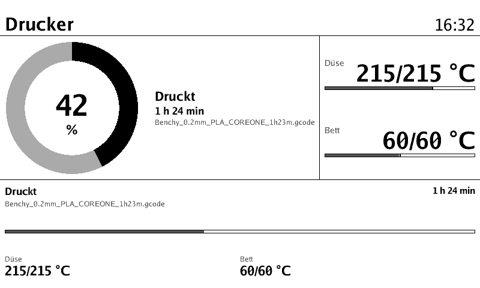
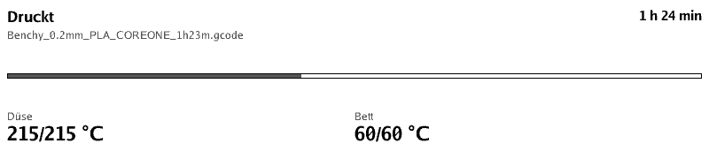
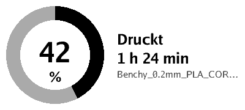
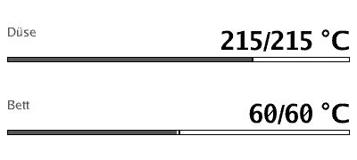

# prusalink plugin

Shows the state of a Prusa 3D printer: whether a job runs, how far it is, when
it ends, the file name and the temperatures of the nozzle and the bed. The
plugin reads the local [PrusaLink](https://github.com/prusa3d/Prusa-Link-Web/blob/master/spec/openapi.yaml)
API of the printer. It needs no cloud account.

PrusaLink is part of the firmware of the MK3.5, MK4/MK4S, CORE One and MINI.
Enable it under *Settings → Network → PrusaLink* and copy the API key from the
same page.

## Screenshots

The example page `drucker` with the progress on the left, the temperatures on
the right and the printer card below:



| `printer` | `progress` | `temperatures` |
|---|---|---|
|  |  |  |

The `drucker` text page on a 20 × 4 display:

```text
Drucker             
Druckt   Benchy_0.2m
 42 %       1h 23min
Düse 215     Bett 60
```

The temperatures leave the degree sign out to fit both into twenty columns.

## Configuration

| Key | Description |
|---|---|
| `url` | Required: the printer address, e.g. `http://prusa-core-one.local` |
| `api_key` | Required: the PrusaLink API key from the printer's network settings |
| `refresh` | How often the printer is read, default `1m`, at least `30s` |

**Demand:** Paperboy names the next moment a display needs the data and the
plugin reads then, never more often than `refresh`
([ADR 0126](../adr/0126-a-schedule-event-for-plugin-demand.md)). A page that no
display shows costs no request. The plugin requires Paperboy protocol 9.

```yaml
plugins:
  prusalink:
    config:
      url: http://prusa-core-one.local
      api_key: ${PRUSALINK_API_KEY}
```

The API key is the password of the printer's HTTP Digest login; the user is
always `maker`. `${PRUSALINK_API_KEY}` keeps the secret out of
`paperboy.yaml`. A printer that only answers on `https` works as well, but its
certificate must be trusted by the machine that runs Paperboy.

## Data source

One fetch reads `/api/v1/status`, which carries the state, the progress, the
remaining time and the temperatures. While the status names a job, the plugin
also reads `/api/v1/job` for the file name; the endpoint answers `204` without
a job. `/api/v1/info` is read once for the printer name.

The first request sends the key as `X-Api-Key`. When the printer asks for HTTP
Digest instead, the plugin answers the challenge and reuses it for the later
requests ([ADR 0149](../adr/0149-a-prusalink-plugin-for-printer-status.md)).
A failed request keeps the last data, and the plugin tries again within 30
seconds. A printer that misses two requests in a row shows *Printer offline* in
every widget, about 30 seconds after the first failure. A printer that never
answered is offline at once
([ADR 0159](../adr/0159-show-an-offline-printer-in-the-prusalink-widgets.md)).

The plugin only reads. It cannot start, pause or stop a print.

## Widget `printer`

The state, the file name, the progress bar, the remaining time and the
temperatures in one card. The bar takes the middle of the cell, so a tall cell
keeps its shape. A printer without a job shows the state, *no job* and the
temperatures.

No arguments.

## Widget `progress`

The progress as a ring with the percentage inside. The state, the remaining
time and the file name stand beside the ring. Without a running job the widget
shows the state and the last file name, or *no job*.

No arguments. Use it where the progress matters more than the temperatures.

## Widget `temperatures`

The nozzle and the bed as a number each, with the target after a slash. A
gauge below shows the current heat against the scale of the heater: 300 °C for
the nozzle and 120 °C for the bed. A tick marks the target.

No arguments.

## Values

A text page reads these values
([ADR 0111](../adr/0111-text-pages-from-plugin-values.md)). A value the plugin
cannot read becomes `–`:

| Value | Type | Base unit | Meaning |
|---|---|---|---|
| `state` | enum | | `idle`, `busy`, `printing`, `paused`, `finished`, `stopped`, `error`, `attention`, `ready` or `offline` |
| `progress` | number | % | progress of the active job |
| `time-remaining` | duration | | time until the print ends |
| `time-printing` | duration | | time since the print started |
| `nozzle` | number | °C | current nozzle temperature |
| `bed` | number | °C | current bed temperature |
| `job` | text | | display name of the file |

An offline printer answers `offline` as its state, and the other values answer
a dash. A plan trigger can test the key, and a text page can label it.

```yaml
kind: text
cells:
  - { at: [0, 1], span: [8, 1], value: prusalink/state,
      labels: { printing: Druckt, paused: Pausiert, idle: Bereit, offline: Offline } }
  - { at: [8, 2], span: [12, 1], value: prusalink/time-remaining, align: right }
```

A plan shows the printer page while a print runs
([ADR 0158](../adr/0158-plans-are-pages-refresh-windows-and-triggers.md)):

```yaml
triggers:
  - when: [{ value: prusalink/state, is: [printing, paused] }]
    page: drucker
```

The key `offline` works like the others, so a second trigger can show a page
while the printer is off.
