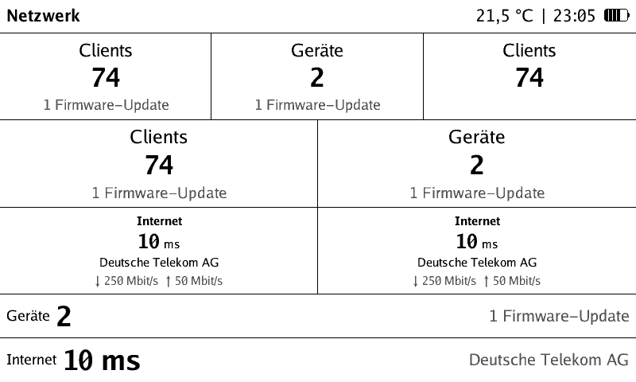

# unifi plugin

Shows the state of a UniFi home network. It shows how many devices and clients
the controller knows, how many devices are offline, and the short WAN summary.
The plugin reads the documented UniFi integration API for the sites, the devices
and the clients. It reads the controller's private `stat/health` endpoint for the
WAN summary. It needs no cloud account.

Create the API key in the controller settings under *Integrations*. The key
works on the integration API and on the private endpoint.

## Screenshots

The example page `netzwerk` shows both widgets in their shapes:




The `netzwerk` text page on a 20 × 4 display:

```text
Netzwerk
Updates verfügbar
Geräte 2  Clients 74
1 Firmware-Update
```

## Configuration

| Key | Description |
|---|---|
| `url` | Required: the https address of the controller, e.g. `https://192.168.1.1` |
| `api_key` | Required: the API key of the UniFi integration, sent as `X-API-KEY` |
| `site` | The site to read, by name or id; without it the first site is used |
| `refresh` | How often the controller is read, default `5m`, at least `1m` |
| `insecure` | Accept the controller's own TLS certificate, default `false` |
| `wan` | Read the WAN summary and count its status in `state`, default `true`. Off skips the private request and leaves the WAN line, `latency` and the health status out of `state` |

**Demand:** Paperboy names the next moment a display needs the data and the
plugin reads then, never more often than `refresh`
([ADR 0126](../adr/0126-a-schedule-event-for-plugin-demand.md)). The plugin reads
once at start. A page that no display shows costs no request. The plugin
requires Paperboy protocol 9.

```yaml
plugins:
  unifi:
    config:
      url: https://192.168.1.1
      api_key: ${UNIFI_API_KEY}
```

`${UNIFI_API_KEY}` keeps the secret out of `paperboy.yaml`. The controller
serves a certificate of its own; set `insecure: true` when the machine that runs
Paperboy does not trust it.

## Data source

The plugin reads the documented integration API under
`/proxy/network/integration/v1` on a UniFi OS console for the site list, the
devices and the clients.
It resolves the site on its first fetch. The plugin keeps it until the process
restarts: the site `id` addresses the integration API, the `internalReference`
addresses the private path.

The client count is the `totalCount` of a one-entry page. The plugin reads the
device list page by page. A site with more than 200 devices costs one more
request per page, and still counts every device.

The short WAN summary comes from the private endpoint
`GET /proxy/network/api/s/{internalReference}/stat/health`. That endpoint is not
part of the documented API. All requests send the key as `X-API-KEY`. With
`wan: false` the plugin skips this request.

The plugin reads the `wan` and the `www` entries of the health answer. It ignores
the rest, including `uptime_stats`: its keys are interface names, not the
configured WANs, and a standby WAN reports 0 percent. `xput_up` and `xput_down`
are speedtest results; the live throughput is `tx_bytes-r` and `rx_bytes-r`.
The widget shows the last result in Mbit/s. A console without a speed test
reports 0, and the plugin then shows no rate.

A failed request keeps the last data. A failed private call is logged once and
never discards the fresh devices and clients. The plugin only reads. It changes
nothing on the controller.

## Widget `status`

The widget is for image displays. The declared sizes are 2 × 2, 3 × 2 and 6 × 1,
with a minimum of 120 × 60 px. It shows one large value, the client count, and
one status line. With `focus: devices` the large value is the device count.

The status line names the most important fact. It shows the name of the first
offline device, then the number of firmware updates, then the WAN summary
`<ISP> - <latency> ms`, then nothing. An offline device wins over firmware
updates. The plugin counts a device as offline unless the controller reports
`ONLINE`, `UPDATING` or `GETTING_READY`. The firmware count covers devices that
update now and online devices with an update available.

| Argument | Description |
|---|---|
| `focus` | Which count is the large value: `clients` (default) or `devices` |
| `detail` | Show the status line, default `true` |

A 2 × 2 or 3 × 2 cell stacks the label, the large value and the status line. A
6 × 1 cell puts the label and the value on the left and the status line on the
right. Without `detail` the status line is left out and the value gets the room.

Counts are integers and follow the request language. The label and the status
line follow it too: `Geräte`/`Devices`, `1 Firmware-Update`/`1 firmware update`.
The WAN summary is the same in both languages. Without data the value is `–`.

## Widget `wan`

The widget is for image displays. It shows one status for the whole connection,
never one row per WAN. The declared sizes are 2 × 2, 3 × 2 and 6 × 1, with a
minimum of 120 × 60 px. The large value is the latency in milliseconds. The
provider name sits below it. When the internet test fails the value is `–`.

A note names the failure in the request language: `Internet gestört` when
`www` is not ok, and `Anschluss gestört` when `wan` is not. The widget needs
`wan: true`. Without it the plugin answers an error and Paperboy draws the
notice.

| Argument | Description |
|---|---|---|
| `speed` | Show the result of the last speed test, default `true` |
| `traffic` | Show the rate of the last fetch, default `false` |
| `ip` | Show the public address of the connection, default `false` |

The speed line sits below the provider: `↓ 250 Mbit/s  ↑ 50 Mbit/s`. It needs a
speed test on the console. A 6 × 1 cell puts the label and the value on the left
and the provider on the right. The note replaces the provider there. The
`speed`, `traffic` and `ip` arguments apply to the stacked cells; the wide row
drops them.

## Values

A text page reads these values
([ADR 0111](../adr/0111-text-pages-from-plugin-values.md)). A value the plugin
cannot read becomes `–`; `state` answers no key instead, so no plan condition
matches while there is no data:

| Value | Type | Base unit | Meaning |
|---|---|---|---|
| `state` | enum | | `ok`, `attention` or `degraded`. Degraded: the WAN or internet status is not ok (both need `wan`), or a device is offline. Attention: a device has firmware work. Empty without data |
| `clients` | number | | clients the controller knows |
| `devices` | number | | devices the controller knows |
| `offline` | number | | devices that count as offline |
| `worst` | text | | the status line. Empty when it has nothing to say: no offline device, no firmware update, and no WAN summary (`wan` off, no ISP name or no latency) |
| `latency` | number | ms | internet latency from the health answer; `–` when `wan` is off or the answer has no latency |
| `download` | number | Mbit/s | result of the last speed test; `–` when no test ran |
| `upload` | number | Mbit/s | result of the last speed test; `–` when no test ran |

A plan shows the network page while the state is degraded
([ADR 0158](../adr/0158-plans-are-pages-refresh-windows-and-triggers.md)):

```yaml
triggers:
  - when: { value: unifi/state, is: [degraded] }
    page: netzwerk
```
