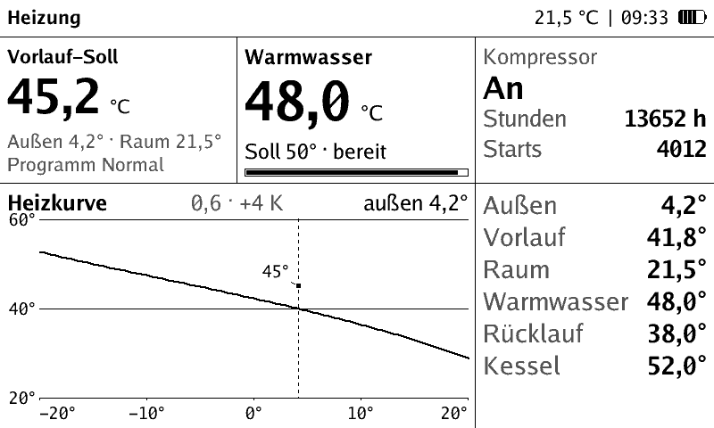
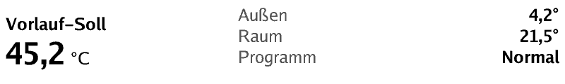
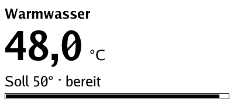
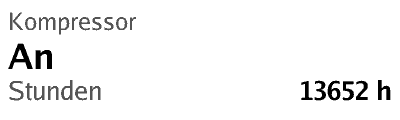
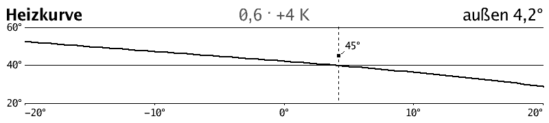
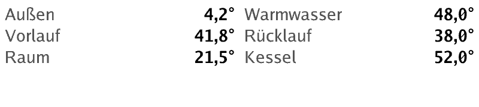
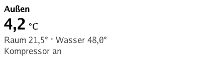

# vicare plugin

Shows a Viessmann heating system through the official API of the [Viessmann
developer portal](https://developer.viessmann-climatesolutions.com). The data
comes from the ViCare cloud, so the heating system must be online in the ViCare
app through its Vitoconnect or its built-in gateway. There is no local
interface for the current device generation.

The plugin reads every device of one gateway with one call per refresh. The
widgets show the heating circuits, the domestic hot water, the burner or the
compressor, the heating curve and the state of the device. Values give a text
page the same data.

## Screenshots

The example page `heizung` shows the heating circuit, the hot water, the
compressor and the heating curve:



| `heating` | `dhw` | `burner` |
|---|---|---|
|  |  |  |

| `curve` | `temperatures` | `status` | `overview` |
|---|---|---|---|
|  |  |  |  |

The `heizung` text page on a 20 × 4 display:

```text
Heizung             
Außen 4,2  Raum 21,5
Wasser 48,0  VL 41,8
Kompressor an Normal
```

## Login

The API uses OAuth2 with PKCE. A personal client and a ViCare account are
needed, and the login happens once by hand:

1. Open the [developer portal](https://developer.viessmann-climatesolutions.com)
   and log in with the ViCare account.
2. Create a client under *My Dashboard → Your clients*: any name, Google
   reCAPTCHA disabled, redirect URI `vicare://oauth-callback/everest`.
3. Run the plugin once with `-login` and paste the code from the browser. The
   program prints the refresh token, the installation, the gateway and the
   device.
4. Put the values into `paperboy.yaml`.

The browser cannot open the `vicare://` address; its address bar carries the
`code` parameter. The helper accepts the whole address or only the code. It
prints a ready config block.

## Configuration

```yaml
plugins:
  vicare:
    config:
      client_id: ${VICARE_CLIENT_ID}
      refresh_token: ${VICARE_REFRESH_TOKEN}
      installation: "1234567"
      gateway: "7XXXXXXXXXX"
      device: "0"
      refresh: 10m
```

| Key | Description |
|---|---|
| `client_id` | Required. Client ID of the personal API client in the developer portal. |
| `refresh_token` | Required. Refresh token printed by `-login`, preferably via `${VICARE_REFRESH_TOKEN}`. |
| `installation` | Installation ID. Discovered from the account when empty. |
| `gateway` | Gateway serial. Discovered when empty. |
| `device` | Device ID on the gateway. Without it the plugin takes the device of type `heating`. |
| `refresh` | Shortest interval between reads, default `10m`, at least `5m`; shorter values are raised to `5m` with one log line. |
| `base` | API base URL, default `https://api.viessmann-climatesolutions.com`. |
| `iam` | Token host, default `https://iam.viessmann-climatesolutions.com`. Only for a proxy or a test. |

**Rate limit:** the free Basic plan allows about 1450 calls a day. One
gateway-wide call per 10 minutes uses about 144 calls a day. A `429` is
answered by waiting for `Retry-After` or one hour, and the last data stays on
screen. A failing request is retried at the next interval, not in a loop.

**Demand:** Paperboy names the next moment a display needs the data and the
plugin reads then, never more often than `refresh` ([ADR 0126](../adr/0126-a-schedule-event-for-plugin-demand.md)).
Between those moments it answers every request from the last snapshot. A page
that no display shows costs no request. The plugin requires Paperboy protocol
9; an older host is refused with a clear error.

**Restarts:** the plugin keeps the snapshot, the fetch times and the current
tokens as plugin state ([ADR 0081](../adr/0081-plugin-state-over-the-protocol.md),
[what a plugin keeps](../design/05-plugins.md#what-a-plugin-keeps)). A Paperboy
restart within the refresh interval therefore costs no request and shows the
last state at once. A changed configuration discards the state; the fingerprint
covers the client ID, the IDs and the seed token.

**Tokens:** Viessmann rotates the refresh token. The plugin keeps the current
one in `state/plugins/vicare/state.json` and renews the access token itself, so
the file holds a credential and is as sensitive as `paperboy.yaml`. If the
state is lost after a rotation, the seed in the configuration no longer works;
run `-login` again. A token that the API refuses fails the widgets with a
notice that names `-login`.

**Feature names differ** between boilers, heat pumps, pellets systems and
devices with solar thermal. A missing feature stays absent, and a widget leaves
its line out instead of inventing a value. Temperatures are in °C.

## Widgets

All widgets are for image displays; the values below give a text page the same
data. `circuit` names the heating circuit and falls back to the first one.

- `heating`: the flow target as the large value, outside and room temperature,
  the active program and the state of the burner or the compressor. Args:
  `circuit` (default 0), `room` (default `true`).
- `temperatures`: outside, flow, room, DHW, return and boiler temperature as
  rows; missing ones are left out. Args: `circuit` (default 0), `max` (default
  6, 2 to 8).
- `dhw`: the storage temperature with a bar to the target, the charging state
  and the operating mode. Args: `meter` (default `true`).
- `burner`: the burner of a boiler or the compressor of a heat pump with its
  state, modulation, hours and starts; a hybrid device names the other heat
  generator. Args: `stats` (default `true`).
- `status`: the device model, the age of the data, the program of every
  circuit and the first error. Args: `errors` (default `true`).
- `overview`: outside temperature as the large value with room, hot water and
  the heat generator, for small cells. Args: `circuit` (default 0).
- `curve`: the heating curve with the target at the current outside
  temperature, as described below. Args: `circuit` (default 0), `outside_min`
  (default −20), `outside_max` (default 20), `formula` (`auto`, `boiler` or
  `heatpump`, default `auto`).

## Values

A text page reads these values ([ADR 0111](../adr/0111-text-pages-from-plugin-values.md));
a value the device did not report becomes `–`:

| Value | Type | Unit | Precision | Meaning |
|---|---|---|---|---|
| `outside` | number | °C | 1 | outside temperature |
| `room` | number | °C | 1 | room temperature of the first circuit |
| `flow` | number | °C | 1 | flow temperature of the first circuit |
| `flow_target` | number | °C | 1 | flow target of the first circuit |
| `dhw` | number | °C | 1 | hot water storage temperature |
| `dhw_target` | number | °C | 1 | target of the hot water storage |
| `burner` | text | | | `Brenner an`, `Brenner aus`, `Kompressor an` or `Kompressor aus` |
| `program` | text | | | active program of the first circuit |
| `state` | enum | | | `ok` or `error`; `error` means at least one active device error |
| `curve_slope` | number | | 1 | slope of the heating curve |
| `curve_shift` | number | | 0 | shift of the heating curve, in K |
| `model` | text | | | device model from the account |
| `updated` | timestamp | | | time of the newest feature |

## The heating curve

The API reports the heating curve of a circuit as `slope` and `shift` only. The
flow target is computed with the outside temperature and the room setpoint of
20 °C. PyViCare found two shapes in the firmware: one for a boiler or a heat
pump with several circuits, and one for a heat pump with a single circuit, which
is 5 K higher. `formula: auto` takes the second shape for a heat pump with one
circuit; `formula: boiler` and `formula: heatpump` name it directly.

The computed curve is an approximation. The widget therefore marks the flow
target that the device reports for the current moment when it has one, and a
device without a curve shows a notice. Small devices of the Vitodens 100, 050
and 111 families do not report a curve.

## Data source

The plugin reads:

- `/iot/v2/features/installations/{id}/gateways/{serial}/features?includeDevicesFeatures=true`
  for the features of every device on the gateway, and
- `/iot/v2/equipment/installations?includeGateways=true` once, to discover the
  IDs, the model and the roles of the device.

The features it uses are `heating.sensors.temperature.outside`,
`heating.boiler.sensors.temperature.main`, `heating.sensors.temperature.return`,
`heating.dhw.*`, `heating.burners.0.*`, `heating.compressors.0.*`,
`heating.circuits.<n>.*`, `heating.circuits.<n>.heating.curve` and
`device.messages.errors.raw`. The DHW sensor is named `hotWaterStorage` by older
and `dhwCylinder` by newer devices; the plugin reads both.

The API belongs to the operator's ViCare account and is meant for that
installation. Follow Viessmann's terms for the developer portal.
