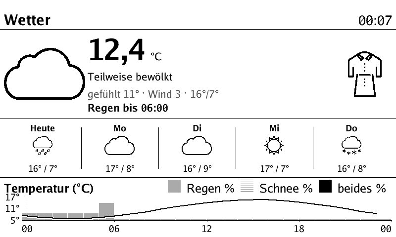
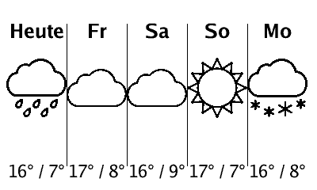
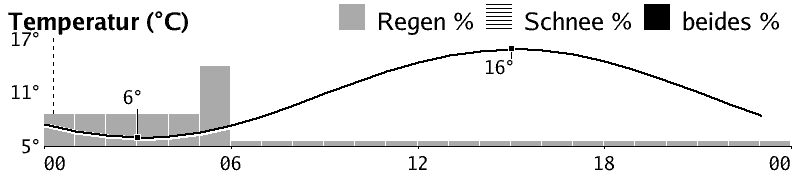

# weather plugin

Weather from [Open-Meteo](https://open-meteo.com/), no API key needed.

## Screenshots

The example page `wetter` shows the current weather, the next five days and
today's temperature curve:

| `current` | `days` | `hours` |
|---|---|---|
|  |  |  |

## Configuration

| Key | Description |
|---|---|
| `lat`, `lon` | Required |
| `refresh` | Default `15m` |
| `base` | Another Open-Meteo address |

**Demand:** Paperboy names the next moment a display needs the forecast and the plugin reads then, never more often than `refresh` ([ADR 0126](../adr/0126-a-schedule-event-for-plugin-demand.md)). A page that no display shows costs no request. The plugin requires Paperboy protocol 9.

## Widgets

All widgets are for image displays.

- `current`: pictogram, temperature, condition, apparent temperature, wind force, today's range and the next precipitation of the day, e.g. `Rain from 14:00, about 2 h`, `Rain until 15:00` or `No rain today`.
- `days`: pictogram and range per day. Args: `days: 1..5`.
- `hours`: today's temperature as a line with the precipitation probability as bars. The fill names the type: rain shaded, snow hatched, a mixed hour solid. The heading names the fill patterns, the dashed line marks now. Args: `mark` (`none`, `min`, `max`, `both`) labels the lowest and the highest temperature; default `none`. `legend: false` drops the three fill entries, so a short cell keeps the room for the plot.

An event is a contiguous run of hours with at least 0.1 mm. Open-Meteo gives precipitation as water equivalent, so snow counts too. An hour with rain and snow is mixed. The plugin decides about the event at render time, so an old forecast still says when a running event ends.

The pictograms come from [OpenMoji](https://openmoji.org) (CC BY-SA 4.0, see `plugins/cmd/weather/icons/README.md`).

## Values

A text page reads these values ([ADR 0111](../adr/0111-text-pages-from-plugin-values.md), [0120](../adr/0120-arguments-for-values.md)). `forecast` reads the argument `days`, 1 to 5 (default 5):

| Value | Type | Unit | Precision | Meaning |
|---|---|---|---|---|
| `temperature` | number | °C | 1 | now |
| `apparent` | number | °C | 1 | feels like |
| `humidity` | number | % | 0 | relative humidity |
| `precipitation` | number | mm | 1 | now |
| `precipitation-probability` | number | % | 0 | now |
| `precipitation-today` | number | mm | 1 | today's sum |
| `precipitation-next` | text | | | the next event as in `current` |
| `wind` | number | km/h | 1 | now |
| `beaufort` | number | Bft | 0 | wind force |
| `condition` | text | | | condition in the global language |
| `min-today` | number | °C | 1 | lowest today |
| `max-today` | number | °C | 1 | highest today |
| `sunrise` | timestamp | | | today |
| `sunset` | timestamp | | | today |
| `updated` | timestamp | | | time of the forecast |
| `forecast` | text | | | one line per day: label, condition and range |

`paperboy` formats the numbers and the timestamps; the plugin never pads or
aligns them.
