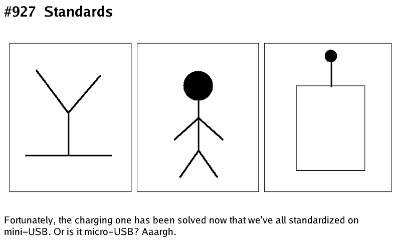
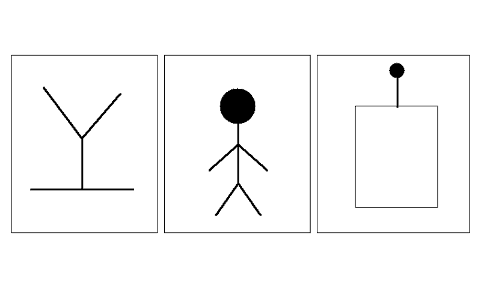

# xkcd plugin

Comics from [xkcd](https://xkcd.com) through its JSON API (`info.0.json`). The plugin downloads the image from the comic's `img` URL in the background and sends a change event when another comic is shown.

## Screenshots

The example page `comic` with a full-screen comic:

The picture above is a placeholder that the screenshot generator draws. The
repository ships no xkcd comic.

## Configuration

| Key | Description |
|---|---|
| `comic` | `latest` (default), `random` or a comic number |
| `refresh` | How often `latest` is checked, default `1h`, at least `1m` |
| `rotate` | How often `random` picks a new comic, default `24h` |
| `base` | Another xkcd address |

**Demand:** Paperboy names the next moment a display needs the comic and the plugin fetches then, never more often than `refresh` ([ADR 0126](../adr/0126-a-schedule-event-for-plugin-demand.md)). Removing the page from every plan stops the checks. The plugin requires Paperboy protocol 9.

## Widget `comic`

The widget is for image displays. The comic is scaled to fit the cell with its aspect ratio kept (Catmull-Rom on gray values, transparent areas turn white) and then reduced to the display's gray levels. Very wide strips and very tall comics only get smaller. Text sizes follow the page's base text.

Args: `title: true` adds the number and title above the comic, `alt: true` adds the alt text below.

## Values

A text page reads these values ([ADR 0111](../adr/0111-text-pages-from-plugin-values.md)):

| Value | Type | Precision | Meaning |
|---|---|---|---|
| `number` | number | 0 | comic number |
| `title` | text | | title |
| `alt` | text | | alt text; a `wrap` box reflows it |

The comics are by Randall Munroe and licensed under [CC BY-NC 2.5](https://creativecommons.org/licenses/by-nc/2.5/). Paperboy does not redistribute them, but keep the attribution and non-commercial terms in mind when you show them.
